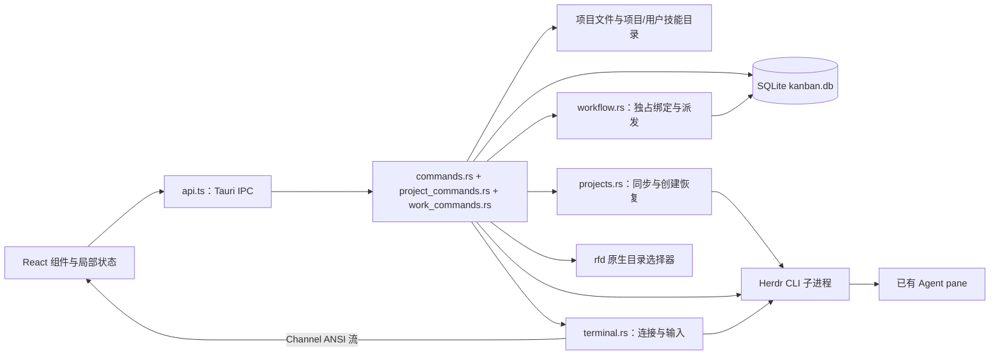
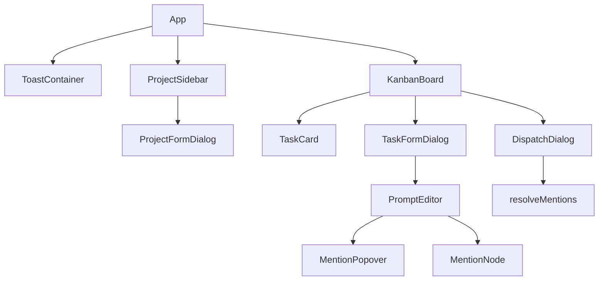
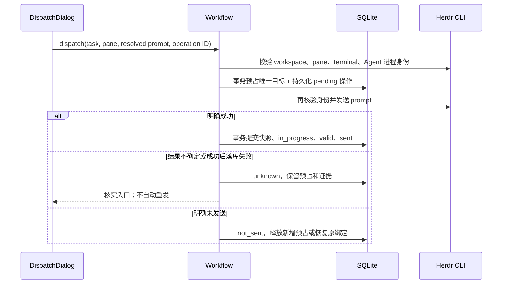

# Kanban 代码结构与关键流程分析

2026-10-24 图片输入增量：新建/编辑任务支持剪贴板图片、120px 缩略图、悬停删除及点击放大；图片持久化与两种派发路径见 6.3.1。实际通过的验证及原生 Ctrl+V 未覆盖项见[图片输入验收记录](docs/verification/2026-10-24-kanban-image-input.md)。

更新日期：2026-10-24（新增首批重构：测试按场景拆分与 Herdr 适配职责提取；修复终端右侧列裁切；修复项目及用户级技能发现；新增异常任务删除；新增 Windows 一键打包与原路径更新；修复 workspace 顺序及关闭后的导航隐藏；移除顶部 Agent 派发栏；修复 Codex 会话归属与命令行恢复；新增启动受理与后台准备；新增卡片 Agent 状态与等待反馈置顶；保留 Skill 候选修复、Herdr workspace 同步、统一任务表单、归档及终端增量）。范围：`kanban/` 的前端、Rust 后端、数据库及构建配置，项目身份与默认目录直接来自 Herdr，已移除 ContextSwitcher 读取。已加入任务独占 pane、右侧交互终端与恢复流程；验证证据和未覆盖项见[验收记录](docs/verification/2026-10-24-kanban-herdr.md)。

2026-10-24 本次增量：自动启动的任务共用对应 workspace 的 `kanban` Tab，各自独占 pane；并发分配与创建结果核实见 6.6 节，验证见[共用 Tab 验证记录](docs/verification/2026-10-24-kanban-shared-tab.md)。

## 1. 项目定位与架构边界

Kanban 是同一仓库中的独立桌面应用，使用 React + TypeScript 构建界面，以 Tauri/Rust 提供 SQLite、文件系统、原生目录选择和 Herdr CLI 调用能力。它不是 Python/PySide6 主程序中的一个页面，也没有直接调用主程序的 TaskManager 或 WindowManager。

业务中心是“为本地项目维护任务卡片，编辑带文件/技能引用的提示词，自动分配或手动选择 Herdr Agent，并保存可恢复的 Codex 会话”。当前已形成项目管理、三列看板、提示词编辑、引用搜索和派发的基本闭环。

必须区分三个概念：

| 概念 | 当前职责 | 关系的实际约束 |
| --- | --- | --- |
| ContextSwitcher Task | Python 主应用管理的窗口上下文及任务 | Kanban 不再读取或同步 |
| Kanban Project | 看板容器，关联 Herdr session + workspace ID，缓存名称与目录 | 同一 session 中 workspace 关联唯一；旧歧义项目保留待关联 |
| Kanban Task | 项目中的单张卡片，含状态、提示词及最近一次派发信息 | 不等同于主应用 Task，也不映射主应用的 `todo_items` |

Project 的稳定身份来自 Herdr；旧 `cs_task_id` 仅作为历史字段保留。名称同步不修改任务、绑定或会话身份。



没有业务 HTTP 服务或 Agent 业务完成回调。启动由应用持有后台线程，生命周期变化发出任务通知，持久化记录负责恢复；应用退出后不继续执行。CRUD 通过 `invoke → Promise` 请求/响应传递；终端输出通过 Tauri Channel 流式传递。Herdr 继续拥有底层 Agent 进程；看板管理查看连接，并通过任务流转命令创建、准备及关闭任务 pane。

## 2. 目录与入口

```text
kanban/
├─ package.json / package-lock.json  前端依赖与 npm 脚本
├─ vite.config.ts                   Vite、开发端口、HMR
├─ tsconfig*.json                   TypeScript 编译约束
├─ index.html                      WebView 页面入口
├─ src/
│  ├─ main.tsx                     React 挂载，启用 StrictMode
│  ├─ App.tsx                      项目列表、项目选择及顶层布局
│  ├─ App.css                      全局主题、布局、组件样式与动画
│  ├─ Icon.tsx                     本地 SVG 线性图标
│  ├─ types.ts                     前端数据结构
│  ├─ api.ts                       Tauri IPC 及启动变化事件适配层
│  ├─ taskFlow.ts                  启动投影列、未决守卫及准备文案
│  ├─ useTaskFlowUpdates.ts         启动事件、前台 2 秒及焦点对账
│  ├─ ProjectSidebar.tsx           项目列表和管理入口
│  ├─ ProjectFormDialog.tsx        新建/关联 Herdr workspace、改名及回退目录
│  ├─ useProjectSync.ts            启动/焦点/前台 15 秒同步，请求合并
│  ├─ WorkspaceRecovery.tsx        未决 workspace 创建核实与显式认领
│  ├─ board-tests/                 按导航、表单、删除归档、状态、选择、派发与后台启动分组的组件回归；fixtures 隔离每个用例
│  ├─ KanbanBoard.tsx              卡片加载、三列、拖拽及弹层协调
│  ├─ TaskCard.tsx                 紧凑卡片、优先级及编辑/完成/删除/归档入口
│  ├─ agentStatus.tsx              实时身份匹配、状态语义及卡片状态圆点
│  ├─ useAgentStatus.ts            前台 3 秒查询、焦点刷新、合并请求及迟到结果隔离
│  ├─ PrioritySelect.tsx           创建与编辑共用的三档优先级选择
│  ├─ TaskFormDialog.tsx           新建/编辑共用居中弹窗：标题、提示词、优先级
│  ├─ PromptEditor.tsx             Tiptap 初始化与 JSON 输出
│  ├─ imagePaste.ts               图片 paste、导入占位与异步图文顺序
│  ├─ PromptImageNode.tsx / ImagePreview.tsx  缩略图、悬停删除、大图与焦点恢复
│  ├─ useImageDraft.ts             表单独立的惰性图片草稿及迟到关闭
│  ├─ imageInput.test.tsx          图片表单、撤销、多图顺序及预览回归
│  ├─ MentionNode.ts              自定义原子行内 mention 节点
│  ├─ MentionPopover.tsx           @/$ 搜索、键盘选择和节点插入
│  ├─ DispatchDialog.tsx           Agent 选择、预览和派发
│  ├─ TerminalPanel.tsx            xterm 渲染、输入、尺寸、连接代次
│  ├─ terminalScroll.ts           连接级滚轮换算、有界队列、字符区命中与失效清理
│  ├─ terminalAppearance.ts        本机 WezTerm 外观预设：字体、光标、ANSI 色板
│  ├─ terminalFontSize.ts           字号快捷键识别、上下限及本机偏好保存
│  ├─ BindingDialog.tsx            显式修复独占绑定，不发送提示词
│  ├─ DispatchRecovery.tsx         核实不确定的派发结果
│  ├─ i18n.ts / locales/           新增界面的稳定翻译键
│  ├─ dispatchUtils.ts             引用展开为最终提示词文本
│  └─ Toast.tsx                    全局通知函数与展示容器
├─ src-tauri/
│  ├─ Cargo.toml / Cargo.lock      Rust 依赖
│  ├─ build.rs                     tauri_build::build()
│  ├─ tauri.conf.json              窗口、构建、资源、安全配置
│  ├─ capabilities/default.json    主窗口权限配置
│  └─ src/
│     ├─ main.rs                   调用 kanban_lib::run()
│     ├─ lib.rs                    初始化数据库、插件与命令注册
│     ├─ db.rs                     数据路径、建表、轻量迁移
│     ├─ models.rs                 Rust 模型及状态转换
│     ├─ commands.rs               CRUD/归档 IPC、文件/技能和 CS 数据读取
│     ├─ skill_discovery_tests.rs  项目/用户技能发现、优先级、去重与截取回归
│     ├─ tasks.rs                  任务存储、优先级排序、归档事务及活跃任务守卫
│     ├─ agent_status.rs           只读 Agent 发现、完整身份匹配及有效任务归属
│     ├─ work_commands.rs          派发、修复、终端的 IPC 适配
│     ├─ lifecycle.rs              自动分配、会话记录、完成清理与启动核实
│     ├─ lifecycle_tests/          共用 fixture 与分配、后台启动、完成清理、恢复场景
│     ├─ start.rs                  持久化受理、后台引用展开及启动通知
│     ├─ images.rs                 附件/引用存储、短事务、后台回收及提示词解析
│     ├─ image_commands.rs         图片草稿、导入、预览及关闭 IPC
│     ├─ image_tests.rs / lifecycle_tests/images.rs  持久化、回收、两种派发与不重发回归
│     ├─ workflow.rs               任务绑定、派发操作及恢复事务
│     ├─ workflow_tests/           独占、派发恢复、任务变更互斥与显式 live 场景
│     ├─ herdr.rs                  Cli/Herdr 对外适配、目标身份核验及 workspace/pane 操作
│     ├─ herdr_cli.rs              无 shell 的有界进程执行、输出及响应错误分类
│     ├─ herdr_workspace.rs        session 文件定位与只读 workspace 目录元数据
│     ├─ herdr_codex.rs            Codex 新建、精确恢复、身份读取与 Windows 单次提交
│     ├─ shared_tab.rs             查找唯一 kanban Tab、选择分屏位置及真实拓扑回归
│     ├─ pane_allocation.rs        同 workspace 分配互斥、创建前快照与未知结果隔离
│     └─ terminal.rs               Herdr JSONL 控制流、输入与安全释放
├─ public/、src/assets/、src-tauri/icons/  静态资源和图标
└─ dist/、node_modules/、src-tauri/target/ 构建产物与依赖目录
```

### 2.1 桌面启动顺序

1. [main.rs](kanban/src-tauri/src/main.rs) 调用 `kanban_lib::run()`；release 模式设置 Windows GUI subsystem。
2. [lib.rs](kanban/src-tauri/src/lib.rs) 创建数据目录，持有数据库实例锁，再打开 SQLite、执行迁移，将上次中断的 pending 派发及生命周期操作标为 unknown。
3. 连接包装为 `Arc<Mutex<Connection>>`，CRUD 与 Workflow 共享。外部 Herdr 请求不持有数据库锁。
4. 注册插件、业务命令、Workflow 和 TerminalManager，再启动 Tauri 窗口；销毁窗口时释放本应用终端连接。
5. [main.tsx](kanban/src/main.tsx) 挂载 `App`；`App` 加载项目，自动选择列表中的第一个有效项目。
6. `KanbanBoard` 按项目 ID 加载卡片，由后端按 Project ID 解析稳定 workspace ID 查询 Agent；卡片成功加载后自动选择第一张开发中任务，已有有效选择则保留。加载期间及没有项目时也保留右侧空终端。

数据库初始化发生在窗口启动前。创建目录、连接和建表失败使用 `expect` 终止，没有恢复界面。数据库命令通过一把 Mutex 串行访问同一连接。

### 2.2 构建与平台

前端声明使用 React 19、Tiptap 3、TypeScript 6、Vite 8；Rust 使用 Tauri 2、rusqlite 0.32（bundled SQLite）、serde、uuid、chrono、walkdir 和 rfd。声明范围与实际锁定版本应分别查看 `package.json` 和 lockfile。

`tauri.conf.json` 配置窗口为 1280×800，最小 900×600，标题为 Herdr Kanban。`dragDropEnabled: false` 配合当前 HTML 拖放实现，不能误当成“应用不支持拖拽”。Vite 固定端口 1420，设置 `TAURI_DEV_HOST` 时另用 1421 提供 HMR。

虽然保留 Tauri 模板的 mobile 入口属性，CS 数据路径依赖 `APPDATA`，外部执行依赖本机 `herdr`；现阶段应按 Windows 桌面工作流理解，不能据此宣称跨平台验收完成。

### 2.3 应用图标

2026-10-24 替换 Tauri 默认应用图标。唯一设计源稿为 [public/app-icon.svg](kanban/public/app-icon.svg)：炭灰圆角底、翡翠绿三列任务卡片，以错落排列形成抽象 H；透明外角，不含文字或外部字体。`index.html` 的 favicon 和 `ProjectSidebar.tsx` 的 32px 品牌图标均引用 `/app-icon.svg`，网页标题为 `Herdr Kanban`。

`src-tauri/icons/` 保存从该 SVG 导出的桌面 PNG、Windows ICO、macOS ICNS 和 Windows 商店图标；`tauri.conf.json` 原有 `bundle.icon` 路径继续生效，`bundle.windows.nsis` 的 `installerIcon` 和 `uninstallerIcon` 显式指定同一份 `icons/icon.ico`，替换 NSIS 自带图标。ICO 包含 16、24、32、48、64、256px。业务操作的线性图标仍由 `Icon.tsx` 提供。

在 `kanban/` 下重新导出时，先生成到临时目录，再只复制顶层桌面资源，避免引入未使用的 Android/iOS 资源：

```powershell
.\node_modules\.bin\tauri.cmd icon public/app-icon.svg --output ../.scratch/kanban-brand-icons
Get-ChildItem -LiteralPath ../.scratch/kanban-brand-icons -File | Copy-Item -Destination src-tauri/icons
```

本次验证：16–128px 深浅背景目视检查、透明通道与 ICO/ICNS 尺寸检查通过；前端构建和 28 项现有测试通过。Windows debug 可执行文件及 NSIS 安装包构建通过，从应用及安装器可执行文件提取的图标均已确认为新设计。因默认 `target/debug/kanban.exe` 正在运行而被占用，构建使用 `--target-dir E:/ContextSwitcher/.scratch/kanban-icon-build`，没有停止当前应用或安装新包。尚未验收新进程的实际任务栏显示、安装后快捷方式缓存及 macOS 显示；前端构建仍有既有大 chunk 提示。

### 2.4 Windows 分发与更新

根目录 [build_kanban.bat](build_kanban.bat) 调用 [scripts/build-kanban.ps1](scripts/build-kanban.ps1)，兼容 Windows PowerShell 5.1。流程为：取得构建锁 → 将当前源码镜像至独立的 `release/kanban-source`（排除依赖和产物）→ 检查 Node/MSVC/SDK/Rust target 及版本一致性 → 在副本执行 `npm ci` → Tauri Windows x64 Release/NSIS 构建，Cargo `--locked` → 将成功产物、SHA256SUMS 和使用说明复制到 `release/kanban/<版本号>/`。Cargo 缓存固定为 `release/kanban-build`，默认并发 4；不覆盖开发目录的依赖及运行中的 debug 程序。脚本完整日志位于 `release/kanban/logs`，失败返回非零码，BAT 保留窗口，成功默认打开产物目录；自动化可传 `-NoPause -NoOpen`。

`tauri.conf.json` 的 bundle.targets 固定为 nsis，installMode 为 currentUser，安装语言为简体中文/英文；WebView2 缺失时联网下载安装。保持现有 productName `kanban`、identifier `com.administrator.kanban` 以及 publisher `administrator`，其中 publisher 从此前推导值变为显式配置，避免注册表安装身份随配置漂移。Tauri 生成的 NSIS 脚本将目录写入 `HKCU\Software\administrator\kanban`，下次安装通过 `RestorePreviousInstallLocation` 自动读回；首次可自选目录，同用户正常重装/升级沿用该路径。版本号不进入默认安装目录。用户手动改目录或显式 `/D=` 可覆盖；跨用户、记录丢失、卸载后重装以及旧 MSI 迁移不在保证范围。

本增量不新增业务 IPC 或数据库迁移。任务仍保存在 `%APPDATA%\herdr-kanban\kanban.db`，与安装位置无关。分发不包含 Node/Rust/Python，也不捆绑 Herdr、Codex 或登录信息；当前没有自动更新服务或代码签名。版本修改方法与环境要求见 [打包说明](docs/kanban-packaging.md)，实际验证和限制见 [打包验收记录](docs/verification/2026-10-24-kanban-packaging.md)。

本次完整 BAT Release 打包和打包副本的 81 项前端测试通过；真实 Windows 11 x64 静默安装的 29 项断言覆盖中文/空格自选目录、同版本重装、0.1.1 测试安装器升级、注册表/文件一致、隔离 SQLite 数据保留及安装后进程启动。0.1.1 测试安装器复用同一应用二进制，不代表新业务版本发布。未逐页验收安装向导、快捷方式、干净系统 WebView2 下载或真实 Herdr/Codex 生命周期。

## 3. 前端组件与状态归属



| 模块 | 拥有的状态/职责 | 与外部的交互 |
| --- | --- | --- |
| [App.tsx](kanban/src/App.tsx) | `projects`、`selectedId`；从列表派生当前项目 | `listProjects`；把刷新函数下传侧栏 |
| [ProjectSidebar.tsx](kanban/src/ProjectSidebar.tsx) | 新建弹窗开关、编辑目标 | 删除前确认；完成 CRUD 后通知 App 重载 |
| [ProjectFormDialog.tsx](kanban/src/ProjectFormDialog.tsx) | 名称、目录、workspace ID、操作 ID、保存状态和错误 | 创建/关联/改名、回退目录、未知结果核实 |
| [KanbanBoard.tsx](kanban/src/KanbanBoard.tsx) | 卡片列表、加载、创建弹窗、拖拽状态、Agent 列表、编辑 ID、待派发对象 | 加载/创建/变更状态；协调编辑与派发弹层 |
| [TaskCard.tsx](kanban/src/TaskCard.tsx) | 展示名称、实时状态圆点、优先级、异常与紧凑图标操作 | 编辑/派发回调；完成交给看板流转；删除/归档调用 API |
| [useAgentStatus.ts](kanban/src/useAgentStatus.ts) | 当前项目独立实时 Agent 列表；可见时 3 秒刷新及焦点刷新 | 共用在途查询、任务刷新作废旧观察，卸载清理监听，失败清空实时状态 |
| [TaskFormDialog.tsx](kanban/src/TaskFormDialog.tsx) | 标题、提示词、优先级草稿及保存/错误状态 | 新建一次创建完整任务；编辑显式保存；失败保留草稿并恢复焦点 |
| [PromptEditor.tsx](kanban/src/PromptEditor.tsx) | Tiptap Editor 实例 | 接收 JSON 字符串；每次编辑输出序列化 JSON |
| [MentionPopover.tsx](kanban/src/MentionPopover.tsx) | 搜索词、引用种类、候选项、选择下标、展开状态 | 查询文件/技能；写入编辑器 transaction |
| [DispatchDialog.tsx](kanban/src/DispatchDialog.tsx) | Agent 列表、选中 pane、loading、错误、预览文本 | 重新查 Agent、展开引用、派发 |
| [Toast.tsx](kanban/src/Toast.tsx) | 通知数组及自增 ID | 模块级 `_notify` 指向容器回调，3 秒后删除通知 |

没有 Redux、Zustand 或查询缓存层。操作回调通知父组件重新查询，刷新期间保留已有卡片；只有首次空列表加载显示 loading 分支。请求代次阻止迟到列表覆盖新结果。App 用 Project ID 作为 KanbanBoard 的 key，切项目销毁旧任务选择、弹窗和终端连接。

表单草稿只存在内存里。任务编辑没有自动保存或未保存提醒；“保存提示词”和“派发提示词”是两个独立动作，派发读取卡片中已保存的 `prompt_json`。

### 3.1 样式与交互实现

[App.css](kanban/src/App.css) 集中定义深色中性色阶、语义色、间距、圆角以及组件样式。2026-10-24 界面调整借鉴 [Supabase 官网](https://supabase.com/) 的中性色、绿色强调、细边框和留白，在现有深色界面上实现：炭灰背景、`#3ecf8e` 主色、6/8px 圆角；根字号为 16px，任务标题、列标题与编辑正文为 16px，操作按钮和辅助文字为 14px，紧凑状态标签为 12px；侧栏宽度 200px，1100px 及以下窗口收为 180px，品牌、底部留白和纵向项目操作按钮适应窄侧栏。左侧三列 grid 等宽、每列至少 180px、间距 8px，看板内容左右留白 12px。右侧终端从窗口内容区顶部贯通到底部，默认占整个应用内容宽度的 1/3，侧栏、看板及分隔线合计占 2/3。首次测量前通过 CSS viewport 宽度保留相同比例；ResizeObserver 在未手调时持续维护默认比例。分隔线支持拖动和方向键，手调后保持像素宽度并随窗口缩小约束上限；最小终端 280px，左侧看板至少 320px。切项目重置默认宽度，不跨重启保存。项目面包屑、目录与任务工具栏位于左侧看板，三列任务区域紧接工具栏，顶部 Agent 派发栏已移除，终端标题和连接状态合并为单行。左侧根据自身宽度收起辅助文字。空间不足时仅三列区域横向滚动；任务新建/编辑弹窗通过 Portal 挂载至 body，相对整个窗口居中，宽 720px、最大宽度 94vw、最大高度 calc(100dvh - 48px)，正文区滚动而头尾固定。弹窗打开时应用根节点 inert，Tab 在表单内循环，关闭后恢复入口焦点。动画包括遮罩淡入、Toast 滑入和加载旋转，并响应系统减少动效设置。

`App` 负责项目侧栏与主区域，`KanbanBoard` 在左侧渲染工作空间面包屑和项目目录层级；`ProjectSidebar` 增加品牌区、项目数量与明确的新建入口，项目选择使用原生按钮；`KanbanBoard` 增加任务总数、完成数量及打开创建表单的顶部新建按钮。`Icon.tsx` 提供本地 SVG 线性图标，替换看板空态与项目操作的字符图标，不加载远程字体或样式。任务卡片、项目表单、任务表单弹窗、派发对话框、引用候选与通知使用同一套主题。

此前主题调整的浏览器模拟检查仅证明界面行为。本次补充了隔离 SQLite、真实 Tauri/WebView2 与 Windows Herdr 的终端输入和生命周期验收；见第 9 节及验收记录。

看板使用原生 `draggable`、`dataTransfer` 与 React 拖放事件，没有使用已经安装的 `@dnd-kit/*`。`draggingIdRef` 是拖放时的首选任务 ID 来源，代码注释说明这是对 WebView2 中 `getData()` 可能为空的兼容措施。

`@tiptap/extension-mention` 也没有用于当前引用链路；项目采用自定义 `MentionNode` 与 `MentionPopover`。前端 opener 包和 Rust opener/shell 插件存在，但业务调用 Herdr 用的是 Rust `std::process::Command`，不是 shell 插件 API。

## 4. 数据模型与持久化

源码入口：[types.ts](kanban/src/types.ts)、[models.rs](kanban/src-tauri/src/models.rs)、[db.rs](kanban/src-tauri/src/db.rs)。前后端模型手工维护，没有生成共享契约。

### 4.1 Project

| 字段 | 作用 |
| --- | --- |
| `id` | Rust 生成 UUID v4 字符串，主键 |
| `name` | 项目展示名称 |
| `root_path` | 文件搜索及新任务启动目录；已有会话/已绑定任务保留原工作目录 |
| `herdr_workspace` | 兼容的展示名称；不再用于查找派发目标 |
| `herdr_session`、`workspace_id` | 稳定关联身份；部分唯一索引保证一个 workspace 一个 Project |
| `sync_status` | ready / unlinked / missing |
| `directory_source`、`herdr_directory` | herdr / missing / cached / fallback / conflict，以及最近权威目录 |
| `cs_task_id` | 仅保留历史值，不触发运行时读取 |
| `created_at` | UTC RFC3339 字符串；未取得 workspace 顺序时作为稳定回退，ID 用于同时间排序 |
| `workspace_order`（仅 SQLite） | 迁移版本 8 新增的可空整数；成功同步时保存 Herdr 列表位置，导航按此排序，未关联/未排序项目置后；无需新增 IPC 模型字段 |

创建在后端校验名称与有效目录，正式关联只接受在线存在的 workspace ID；显式重新关联拒绝改写活跃绑定或未决操作。

### 4.2 Task

| 字段组 | 作用 |
| --- | --- |
| `id`、`project_id` | 卡片主键及所属项目；SQL 声明项目外键 |
| `name`、`status` | 名称与 `todo / in_progress / done` 三态 |
| `prompt_json` | Tiptap 文档的 JSON 字符串；新建表单直接提交正文，旧 IPC 调用省略 promptJson 时兼容 `"{}"` |
| `prompt_snapshot` | 最近一次成功派发时实际发送的展开文本，可为空 |
| `dispatched_at`、`dispatched_to` | 最近一次派发时间与 `workspace/pane_id`，可为空 |
| `priority` | normal / high / urgent，显示一般 / 优先 / 紧急；默认 normal，SQL CHECK 与 IPC 枚举拒绝非法值 |
| `archived_at` | 可空归档时间；非空任务不在看板列表和统计中出现，仍保留 done 状态及所有历史 |
| `created_at`、`updated_at` | 创建及最后修改时间；列表按优先级降序、创建时间升序、ID 稳定排序 |
| `cleanup_required` | 派生布尔值：最近一次 complete 操作 failed/unknown 时为 true；不受后续 start 失败覆盖 |

新增数据表：

| 表 | 约束及用途 |
| --- | --- |
| `task_bindings` | task_id 主键；`UNIQUE(session,pane_id)` 跨项目保障独占；保存完整目标身份和 valid/reserved 状态 |
| `dispatch_operations` | 操作 ID 主键；pending/unknown/sent/not_sent；保存目标、实际 prompt、时间与人工核实依据；部分唯一索引限制每任务一个未决操作 |
| `task_sessions` | 按 task_id 保存 Codex 会话 UUID、目录和更新时间；与活跃 pane 独立 |
| `start_requests` | 启动操作快照：项目/workspace、目录、提示词文档、是否需要首次派发、原状态及阶段；按操作 ID 关联生命周期记录 |
| `lifecycle_operations` | 启动/完成操作 UUID、pending/unknown/succeeded/failed、目标、错误和核实依据；每任务最多一条未决记录 |
| `pane_allocations` | 创建操作 ID、session/workspace、创建前 pane/terminal 清单、返回的目标及 resolved 标记；保留创建证据，任务删除不级联清除 |
| `workspace_operations` | 创建操作 ID、session、请求、已知 workspace ID、Project ID、pending/unknown/succeeded/failed 与错误；重启 pending 转 unknown |
| `workspace_exclusions` | 用户本地删除后的 session + workspace ID；防止自动重新导入 |
| `task_working_directories` | 按任务保存首次启动/派发目录；同步项目目录不覆盖历史上下文 |
| `schema_migrations` | 记录绑定、派发、生命周期与任务字段迁移版本（当前 9；4 加优先级，5 加归档时间，6 加稳定项目身份，7 加后台启动快照，8 加 workspace 导航顺序，9 加图片附件及引用），初始化可重复执行 |
| `prompt_images`、`image_drafts` | 图片 ID、项目归属、名称、MIME、字节数、尺寸及内容摘要；草稿按项目/可选任务独立持有，重启释放未保存草稿 |
| `draft_image_refs`、`task_image_refs`、`operation_image_refs` | 分别保护可撤销的草稿、已保存正文和已受理操作；归档保留引用，删除不抹除已有启动/派发证据 |
| `image_prompt_snapshots` | 手动图片派发的操作 ID、正文及展开文本；重试同一操作使用同一快照，无实际操作记录的孤儿准备在任务删除/应用重开后释放 |

Task 上的 `binding`、`flow` 是列表返回的派生字段，不写入旧 tasks 表。`flow` 包含保存的会话 ID、最近生命周期操作及错误。无活跃绑定但有会话记录时返回 dormant；没有会话记录的旧开发中任务返回 repair，旧共享目标不会自动认领。完成后成功关闭才解除 pane 绑定；缺会话 ID、身份变化或关闭失败时保留目标并提供重试关闭。移回未开发保留绑定；删除解除绑定，保留操作审计记录。`DispatchRecord` 仍是命令返回值，最近一次快照也继续保存在 Task 上。

### 4.3 数据路径、迁移与约束

默认数据库为 `%APPDATA%\herdr-kanban\kanban.db`；隔离验收可设置 `KANBAN_DATA_DIR`。它与 Python 主应用的 tasks.json 独立。启动持有同目录数据库锁，避免第二实例把活跃派发误判为中断；进程退出自动释放锁。

显式启用 `foreign_keys=ON` 和 3 秒 busy timeout。增量建表保留原项目、任务、prompt、快照及目标文本；原有 cs_task_id 迁移仍兼容。status 仍无 SQL CHECK，但状态命令只接受 todo/done，拒绝直接改为 in_progress；进入开发中必须经手动派发或自动启动/恢复工作流。pending/unknown 操作阻止相关任务的冲突操作，并阻止项目删除和身份重新关联；任务删除不受未决状态阻挡；已知身份一致的自动迁移与名称同步可继续，以保留核实证据。关闭中断允许在重新核验原目标后重试。

## 5. IPC 命令契约

[api.ts](kanban/src/api.ts) 是唯一的前端 invoke 入口；[lib.rs](kanban/src-tauri/src/lib.rs) 注册命令；[commands.rs](kanban/src-tauri/src/commands.rs) 实现本地 CRUD，[project_commands.rs](kanban/src-tauri/src/project_commands.rs) 适配 ProjectService，[work_commands.rs](kanban/src-tauri/src/work_commands.rs) 适配派发和终端服务。

参数在 TypeScript invoke 对象中使用 camelCase，例如 `rootPath`、`projectId`；Rust 函数参数和返回结构字段使用 snake_case。Rust 的 `Result<T, String>` 对应前端成功值或 Promise rejection，新增业务错误使用稳定 key 前缀，由 React i18n 映射；CLI 细节作为附加诊断。

| 命令 | 主要输入 | 返回/副作用 |
| --- | --- | --- |
| `list_projects` | 无 | 缓存导航 `Project[]`；按持久化 workspace 顺序排序，隐藏已确认 missing 的关联项目 |
| `sync_projects` | 无 | 同步当前 session 后返回与缓存相同规则的可见 Project、在线 workspace、未决操作快照；完整记录仍在数据库保留 |
| `workspace_operations` | 无 | 当前 session 未决创建记录 |
| `create_project` | name、rootPath、operationId | 先记录意图，再创建 Herdr workspace、核实并关联 Project |
| `recover_workspace` | operationId、可选 workspaceId | 只核实/认领实际创建结果，不重新创建 |
| `link_workspace` | 可选 projectId、workspaceId、可选 fallbackPath | 显式添加或修复关联 |
| `update_project` | id、name、可选 fallbackPath | 稳定 ID 改名，读回实际结果并返回 Project |
| `delete_project` | id | 本地删除并记录排除；不关闭 Herdr workspace/Agent |
| `list_tasks` | projectId | 项目内未归档 Task[]，优先级降序，同级创建时间升序、ID 稳定排序 |
| `create_task` | projectId、name、priority、可选 promptJson/draftId | 同一事务保存任务及正文图片引用，返回 todo Task；省略正文兼容 `{}`，旧无图调用不需要草稿 |
| `update_task` | id、name、promptJson、priority、可选 draftId | 同一事务更新正文和图片引用；校验草稿/任务归属，拒绝归档任务，失败保留原数据 |
| `open_image_draft` | projectId、可选 taskId | 返回草稿 UUID；编辑时保护原任务图片，支持取消和撤销 |
| `import_prompt_image` | draftId、name、mime、base64 data | 校验 PNG/JPEG/WebP，返回稳定图片元数据；解码和文件写入不持应用数据库 Mutex |
| `preview_prompt_image` | draftId、imageId | 校验草稿引用及文件摘要，返回临时预览 data URL |
| `close_image_draft` | draftId | 释放草稿引用并安排独立连接回收，不删除仍被任务或操作引用的原图 |
| `update_task_status` | id、status | todo 直接更新；done 兼容入口转完整完成工作流；拒绝直接 in_progress |
| `start_task` | taskId、operationId | 短事务持久化受理后返回 Flow；后台展开已保存提示词、预占/创建 pane 并启动或恢复；同一操作 ID 不重复执行 |
| `complete_task` | taskId、operationId | 标记完成、保存会话、关闭 pane；返回可为空的 warning |
| `recover_lifecycle` | taskId、operationId | 只核实未知启动，不发送/启动/关闭；确认已派发或精确恢复，或确认启动 pane 已不存在后释放 |
| `delete_task` | id | 本地事务删除卡片，允许未决操作；级联释放绑定/会话/目录，保留操作事实，关闭本应用查看连接 |
| `archive_task` | id | 仅 done 且无未决操作/清理时归档；事务释放独占绑定，保留历史，关闭本应用查看连接 |
| `search_files` | rootPath、query | 最多 50 个 FileEntry |
| `search_skills` | query、可选 rootPath | 项目优先，排序/去重后匹配，最多 30 个 SkillEntry；省略目录仅搜索用户技能 |
| `read_file_content` | absPath | UTF-8 文件全文 |
| `read_skill_content` | skillMdPath | UTF-8 SKILL.md 全文 |
| `herdr_list_agents` | projectId | 后端解析 session + workspace ID，返回 occupied_by、verified_task_id、完整实时 target 和状态；不修改任务或绑定 |
| `dispatch_to_herdr` | taskId、agentName（pane ID）、promptText、operationId、可选 promptJson | 后端从项目解析 workspace；有图正文由后端冻结、解析及校验，再经原独占派发流程；旧无图文本调用兼容 |
| `resolve_dispatch` | taskId、operationId、sent、evidence | 人工核实未知结果，不重发 |
| `repair_binding` | taskId、paneId | 显式验证并替换独占绑定，不重发 |
| `terminal_open` | taskId、connectionId、cols、rows、output Channel | 从任务解析有效目标；创建控制流 |
| `terminal_input` | connectionId、data | 再核验任务、绑定及身份后转发输入 |
| `terminal_scroll` | connectionId、event | 核验任务身份、字符坐标、网格尺寸后批量转发单行滚动 |
| `terminal_resize` | connectionId、cols、rows | 有界尺寸更新 |
| `terminal_ack` | connectionId、bytes | 渲染消费确认，释放输出配额 |
| `terminal_close` | connectionId | 只释放指定查看连接 |
| `pick_folder` | 无 | 原生目录选择结果；取消返回 null |

`dispatch_to_herdr` 的 `agentName` 实际传入 `pane_id`，不是 `HerdrAgent.name`。`name` 是 Agent 类型，`title` 用于展示，`pane_id` 才是发送目标。

## 6. 关键业务调用链

### 6.1 Herdr workspace 同步、创建与恢复

`App → useProjectSync → sync_projects → ProjectService → Herdr CLI + SQLite`。启动先展示本地缓存，焦点及前台 15 秒刷新保持现有列表直至在线成功；显式刷新/本地 CRUD 后允许重新加载持久化导航，使离线本地移除仍能生效。请求合并，迟到结果不覆盖后续刷新。在线失败保留最近有效项目列表及任务，不等同于空列表。

成功同步在同一事务内更新名称、目录、存在状态与 `workspace_order`，顺序直接来自 Herdr workspace 列表，不按名称或 ID 推算。`projects::visible_list` 为缓存 IPC 与在线快照共用导航投影：隐藏 `workspace_id` 非空且 `sync_status=missing` 的项目，未关联旧项目继续保留。内部 `projects::list`/`get` 仍可读取完整记录，供身份匹配、关联与未决操作恢复使用。在线存在但被未决创建保护的已关联项目仍更新存在状态与位置，不误判为关闭。读取或落库失败不提交部分排序/隐藏结果。

关闭只隐藏导航，不删除 Project、卡片、提示词、会话、绑定及操作历史，也不写入本地移除排除记录；同一 session + workspace ID 再次出现复用原 Project ID，同名新 ID 不接管任务。排序保持当前 Project ID、看板和终端；选中项目消失时 App 回退到首个可见项目，没有可见项目则显示空态，原看板卸载释放本应用终端查看连接。同步不关闭 Herdr 资源，也不改变任务业务状态。表单草稿仍独立。

已有 workspace 按稳定 ID 自动导入。旧 Project 优先使用一致的历史绑定/未决目标身份，其次唯一的名称与等价目录；冲突保留待关联，不合并任务。Windows 目录比较统一大小写、斜杠及尾分隔符。

默认目录按在线 ID 从 Herdr version 3 会话数据 `identity_cwd` 只读补充，不读取 pane cwd。默认 session 使用 `%APPDATA%/herdr/session.json`；非默认 session 或自定义 Herdr 配置必须用 `KANBAN_HERDR_SESSION_FILE` 指定对应文件，否则降级。读取上限 8 MiB；格式、目录无效时保留缓存或请求本地回退。回退与后来读取的权威目录不同会显示冲突，由用户明确选择；不会写回 Herdr 会话文件。

`ProjectFormDialog → create_project → 持久化 UUID → workspace create --label kanban-create-<UUID> --cwd <目录> --no-focus → 保存返回 ID → rename → 读回 → 提交 Project`。明确发送前失败可复用原操作重试；响应未知或落库失败只核实已知 ID/标记，不再次创建。歧义由用户显式选择，并保护其他未决操作保留的 ID/标记；已被自动导入的实际结果可就地认领，保留其任务。`WorkspaceRecovery` 在重启后继续核实。

Kanban 改名调用 Herdr 并读回确认；外部改名按 ID 同步。外部调用不持 SQLite Mutex，短事务提交结果。本地删除保留排除记录，不关闭外部资源。旧 ContextSwitcher 读取 IPC、类型和表单入口均已移除。

### 6.2 创建、编辑和移动卡片

1. 顶部“新建任务”按钮或 N 打开 `TaskFormDialog`；列底部没有新增输入区域。字段顺序为标题（必填）、提示词（可空）、优先级（默认一般），提示词复用 Tiptap 的 @ 文件/$ 技能引用。调用 `create_task` 一次提交三个字段。创建失败保留完整草稿并恢复标题焦点，取消不创建；再次打开清空草稿并恢复一般优先级。
2. Rust 使用单条 INSERT 保存完整 todo 卡片，前端关闭新建弹窗并重新加载，不再自动打开编辑。数据库复用已有 prompt_json 字段，无新增迁移。
3. Tiptap 编辑内容经 `getJSON()` 序列化到面板草稿。
4. 点击卡片编辑入口打开同一 `TaskFormDialog`（以任务 ID 为 key）；显式保存调用 `update_task`，同时保存标题、提示词和优先级，成功后关闭弹窗、刷新看板。同列按优先级重排，保留有效的当前终端选择。
5. 卡片拖到“开发中”时立即投影到目标列并选中，显示“窗口准备中”，调用 `start_task` 仅等待本地受理。首次执行在后台展开已保存提示词并发送，已保存会话或保留原绑定的任务只恢复/连接、不重发。准备完成通过通知及查询刷新，不抢回后来选择的任务。拖到“完成”及完成按钮统一走 `complete_task`，关闭失败也刷新完成状态并显示清理警告。拖到“未开发”调用 `update_task_status`；拖到原列不执行更新。任务流转期间禁用该卡片操作和拖拽，并用同步 Set 阻止重复请求。

列之间允许迁移，包括 done 回 todo；从 todo 或 done 拖入 in_progress 自动启动或恢复，无派发确认弹窗。同一列不提供手动排序；后端按紧急、优先、一般，再按创建时间和 ID 排序。前端仅对开发中列做稳定分组，将身份匹配且状态为 blocked 的任务放到顶部；组内保持后端顺序，状态恢复后回到原位置。重排不改变已选任务或终端连接。“标记完成”按钮只出现在 in_progress 卡片；拖放可以把任意状态卡片直接移到 done。

看板快捷键是无 Ctrl/Meta/Alt 修饰的小写 `n`，打开顶部创建表单；标题框 Enter 提交，提示词内 Enter 换行；中文输入法确认不提交。Escape 取消，引用候选打开时先关闭候选。提交中锁定全部字段与取消/关闭入口，并用同步标记阻止重复提交；失败保留草稿。全局快捷键排除 input、select、textarea、contenteditable、已有弹层和右侧终端，终端键盘事件不冒泡至看板。

### 6.2.1 紧凑卡片与归档

卡片标题最多两行，完整名称通过悬停查看；右上角为编辑笔图标，完成卡片旁有归档图标，删除为底部图标。去掉可见时间、重复状态标签与常驻派发目标，优先级文字标签的悬停提示展示目标。普通卡片实测 80～98 CSS px；错误与核实/清理恢复信息可增加高度。紧凑按钮样式仅作用于卡片，不改变终端恢复控件。

`archive_task → tasks::archive` 在同一 SQLite 事务检查 done、未归档、无 pending/unknown 派发或生命周期操作、无未完成的 complete 清理，再写入归档时间、updated_at 并解除 task_bindings；成功后只释放本应用的终端查看连接，不调用 Herdr 关闭 pane、停止 Agent 或发送 prompt。重复归档幂等；事务失败保留卡片、绑定与证据。任务正文、priority、快照、会话及操作历史全部保留。

最近一次 complete 的 failed/unknown 独立派生 `cleanup_required`；后续 start 失败不会掩盖它。前端使用该字段保留清理重试入口，后端重新核对后才允许归档。归档互斥复用生命周期守卫和派发事务；更新、状态改变、派发、开始/完成、修复绑定及终端目标解析均拒绝已归档任务，防止迟到请求重新激活。

归档成功后看板先从本地列表移除该任务并清理相关选择/弹层，再刷新任务和 Agent 占用信息；即使列表刷新失败，卡片与统计也不会回退。归档失败保留卡片并显示错误，不额外弹确认框。本次没有归档列表、恢复归档或批量归档入口。

### 6.2.2 实时 Agent 状态与等待反馈置顶（GitHub #15）

`useAgentStatus → herdr_list_agents → Workflow::list_agents → Herdr::targets`：Herdr 外部查询不持 SQLite 锁，返回后再次核对项目关联。pane 占用仍由 `occupied_by` 表示；仅当前项目中未归档、无未决生命周期操作、绑定 valid 且完整身份一致的任务获得 `verified_task_id`。身份比较使用 session、workspace、pane、terminal、Agent 类型和进程标识，不使用标题或历史状态。前端再与当前任务绑定比较，未决操作、清理失败、身份变化、缺失或查询错误显示 unknown。

任务卡片标题左侧显示 8px 圆点：working 蓝色、blocked 橙色、done 绿色、idle 灰色、unknown 灰色空心；悬停和无障碍名称使用中英翻译键。done 解释为“本轮已结束，待查看”，不修改业务任务状态；idle 是空闲等待输入，blocked 仅表示 Herdr 识别到审批或提问界面，不分析回复中的自然语言。未启动任务显示“未启动”；正常关闭、无活跃绑定的任务显示“会话已关闭”，异常恢复提示继续保留。

当前项目可见时每 3 秒尝试刷新；获得焦点、恢复可见以及任务列表刷新时使旧观察失效并补查。慢请求不重叠，StrictMode 重挂载共享在途请求；隐藏时暂停轮询并清除状态，切项目或卸载不接受旧结果。实时列表不写回 Task/binding/数据库，状态变化不会改变 TerminalPanel 连接身份。查询沿用现有 Herdr CLI 的有界子请求；大量 Agent 或慢进程检查可能延长单轮耗时，不保证严格 3 秒内更新。

验证及限制见[状态验收记录](docs/verification/2026-10-24-kanban-agent-status.md)。

### 6.3 @ 文件与 $ 技能引用

`PromptEditor → MentionPopover → searchFiles/searchSkills → 选择候选 → 插入 MentionNode → prompt_json`。

2026-10-24 技能目录修复：`TaskFormDialog` 已传入 `project.root_path`，现在技能候选与文件候选一样，经 `MentionPopover → api.searchSkills(rootPath, query)` 将目录传至 Rust。`commands::search_skills` 解析可用的 USERPROFILE/HOME，交给 `search_skills_in` 按来源优先级发现技能。空项目目录只搜索用户技能；没有用户目录时仍可搜索项目技能。缺失目录、遍历错误和无法读取的文件逐项跳过，不生成虚假候选。不新增数据库字段或迁移，技能引用保存原有 name/path，发送仍为原生 `$技能名`。

引用候选通过 Portal 挂载至 body，使用 fixed 定位跟随光标，并约束在窗口内；监听编辑器内容/选择、滚动和窗口尺寸变化。长提示词顶部或中部的候选不会被表单滚动区裁剪。键盘捕获阶段处理方向键、Enter/Tab 选择和 Escape 关闭，避免编辑器抢先换行；中文输入法组合期间不消费这些选择键。

候选项采用 14px 符号列与可收缩的文本列；文本列中名称在上、可选描述在下，分别以 16px/14px 显示，长名称和完整描述自然换行，无省略或行数裁剪。弹层首选宽度 360px、最大宽度为窗口减 16px，高度最多 min(280px, 40vh)，长内容通过列表纵向滚动查看，滚动边界不继续传递给表单。查询结果变化后列表回到顶部；上下键切换仅调整候选容器的 scrollTop，超高条目从标题开始显示，不滚动编辑器或表单祖先。鼠标实际移动时更新高亮但不主动滚动；使用 mousemove 而非 mouseenter，避免列表滚动后静止鼠标覆盖键盘选择。文件候选复用同一文本列，无描述时不占用额外描述行。

2026-10-24 [GitHub #14](https://github.com/legendxcheng/ContextSwitcher/issues/14)：真实 React/Tiptap + Chromium、模拟 Tauri IPC 检查复现旧布局名称区域为 0px，修复后为 307px；覆盖长名称/描述、空描述、中文、完整末尾可滚动到达、窗口边界、键盘与鼠标选择、文件引用及新建/编辑保存。54 项前端测试与生产构建通过，保留既有大 chunk 提示。本次未执行原生 WebView2/Herdr 验收或重新打包安装；脚本与证据见[候选提示验收记录](docs/verification/2026-10-24-kanban-skill-popover.md)。

节点保存的是引用位置，不是引用正文：

```json
{
  "type": "mention",
  "attrs": {
    "kind": "file",
    "label": "src/App.tsx",
    "ref": "E:/MyProject/src/App.tsx"
  }
}
```

`kind` 为 `file` 或 `skill`，`label` 展示名称，`ref` 保存搜索返回的路径。自定义节点为 inline + atom，渲染为不可编辑的 chip。

候选触发正则为 `/([@$])([\w./_-]*)$/`，支持拉丁字母、数字、下划线和部分路径字符，不支持中文查询词、空格、反斜杠或盘符冒号。候选列表支持上下方向键、Enter/Tab、鼠标选择；Escape 关闭。

| 搜索能力 | 当前实现与限制 |
| --- | --- |
| 文件搜索 | WalkDir 递归、不跟随符号链接；按文件名做大小写不敏感 contains，非全文、非完整相对路径匹配 |
| 文件排除 | 过滤包含 node_modules、.git、target、__pycache__、.venv、dist、build 的路径；不读取 .gitignore |
| 文件结果 | 先取遍历中的前 50 条，再按相对路径排序；不是全量排序后取前 50 条 |
| 技能搜索 | 依次扫描当前项目 `.agents/skills`、用户 `.agents/skills`、用户 `.codex/skills`、用户整个 `.claude`；递归寻找 SKILL.md 文件，不跟随目录内符号链接 |
| 技能元数据 | 手工从 frontmatter 读取单行 name/description，非完整 YAML 解析；name 缺失或为空时使用父目录名 |
| 技能结果 | 按来源优先级、名称、路径确定顺序；路径及大小写不敏感的同名技能去重，项目副本优先；去重后名称或描述 contains 匹配，最后取最多 30 条 |

文件排除使用迭代后的 `filter`，没有 `filter_entry` 目录剪枝，排除目录仍可能被遍历。查询没有 debounce 或缓存。候选 effect 的 cancelled 标记防止过期结果写回，但不会停止已经发起的 Rust 扫描。

本次 84 项前端测试、78 项 Rust 测试通过，5 项需独立 Herdr 环境的测试按原规则跳过；生产构建通过，仍有既有大 chunk 提示。真实 Chromium + 生产前端验证 `$kanban-dev` 的候选、键盘/鼠标选择、新建/编辑保存及重新打开、切项目隔离；搜索桥接从当前源码提取的 Rust 函数扫描真实目录，Tauri 通信及任务存储为模拟。未验收原生 WebView2/Herdr 技能加载，未重新打包安装。证据与命令见[项目技能发现验收记录](docs/verification/2026-10-24-kanban-project-skills.md)。

### 6.3.1 剪贴板图片、缩略图与持久引用（2026-10-24，GitHub #30–#34）

`TaskFormDialog → useImageDraft → PromptEditor / imagePaste → 图片 IPC → images`。普通文字继续使用原粘贴流程；剪贴板图片在当前光标位置放置导入占位，串行完成导入并按映射后的锚点插入 `promptImage`。占位保持在用户后输入文字之前，同锚点多图按顺序推进；关闭/卸载后的迟到结果不写入其他编辑器。剪贴板同源名称的不同 MIME 表示选取一份，独立文件及 HTML 多图保留顺序。导入未完成时禁用保存，失败保留其他输入；取消只释放本次草稿。

图片节点保存 `imageId/name/bytes`，预览 URL 不进入持久正文。图片按 UUID 保存在数据库同级 `images/`，遵循隔离数据目录；metadata 保存 MIME、尺寸与 SHA-256。支持 PNG、JPEG、WebP，单张 10 MiB / 4000 万像素，正文最多 20 张、累计 50 MiB。导入阶段在数据库锁外解码和同步写入临时文件，再以短事务确认草稿仍有效并提交引用；失败在锁外清理未提交文件。

按用户追加确认的交互，正文仅显示 120×120px 缩略图；鼠标悬停或键盘聚焦时显示右上角删除按钮，删除可撤销。点击缩略图通过 Portal 打开大图，底层任务表单 inert；Escape、关闭按钮或背景点击只关闭大图并恢复缩略图焦点。多图横向排列，窄窗口仍由原表单正文区域滚动。

保存任务及其引用在一个事务内完成。编辑草稿保护原引用，取消不改原任务，失败可重试；归档保留原图。首次启动受理时在原短事务中固定图片引用，后台通过共享解析器生成原图绝对路径和明确 `view_image` 指令；后续编辑不改变该次输入。手动图片派发同样冻结正文及展开文本，旧卡片正文变化会要求刷新；普通文件引用展开和原生技能名称保持原语义。发送前再校验操作图片可读及摘要一致，缺图不静默发送残余文字，发送后的未知结果不重发；恢复旧会话不再解析或发送历史图片。

单任务删除和草稿关闭只安排后台回收，文件操作使用独立 SQLite 连接，不持应用数据库 Mutex。回收保护任务、草稿、已受理启动和真实派发记录的引用；仅在删除/重开边界释放没有实际操作记录的孤儿手动准备。实际操作证据继续保留，不依赖 Herdr 返回才允许删除任务。详情及验证限制见[图片输入验收记录](docs/verification/2026-10-24-kanban-image-input.md)。

### 6.4 派发到 Herdr

手动派发通过未开发卡片“派发”按钮进入；卡片移除“再派发”和常驻“修复绑定”，终端异常修复入口保留，均经 `DispatchDialog` 确认。拖入“开发中”改为自动启动/恢复，详见 6.6。done 卡片拖入开发中恢复旧会话。顶部 Agent chip 及其拖放入口已移除。



**Agent 发现。** 按 Project 保存的 session + workspace ID 验证在线身份，读取 agent list 与 pane process-info；缺失、歧义或无法核实身份的目标不可选。目标身份包含 session、workspace ID、pane ID、terminal ID、Agent 类型以及 shell PID/前台进程组。标题只展示，不参与身份判定。默认使用本机 default session。

派发和修复对话框可以刷新列表，其他任务占用目标显示为禁用；后端数据库约束仍是最终保障。再派发复用已有有效目标。顶部不再展示 Agent 列表；手动派发仍需通过卡片入口打开对话框确认，不直接发送。

**预览。** `buildPreview()` 调用本地 `extractTextWithMentions()`，展示普通文本、`[@文件: ...]` 占位符与原样的 `$技能名`，不读取引用正文。技能的预览与实际发送一致；文件在实际派发时展开。

**实际展开。** [resolveMentions()](kanban/src/dispatchUtils.ts) 递归处理文档：普通文字直接追加；文件正文放入带路径的分隔标题和代码块；技能引用只输出 `$技能名`，不读取或注入 SKILL.md 正文，由目标 Agent 解析技能调用。段落和标题补换行；并非完整 Markdown 序列化，粗体、列表、hardBreak 等结构没有对应的完整格式恢复。

引用读取按文档顺序逐个 await，无缓存和去重。仅文件引用会读取正文，每次派发读取当时的文件内容，可能与编写提示词时不同。单个引用读取失败会替换为“引用失败”文本并继续发送；参数 `_rootPath` 当前未使用，读取路径不会重新限制在项目根目录内。

**执行及落库。** CLI 用参数数组执行，不通过 shell 拼接；常规请求超时 12 秒，Agent 启动外层超时 40 秒（Herdr 启动默认 30 秒），stdout/stderr 各限 4 MiB。操作 ID 防止重复提交，未知结果须人工核实。Windows Codex 使用 `pane send-text` 发送正文，再核验目标身份，然后用 `agent send-keys right enter` 结束粘贴缓冲并提交；不叠加 `agent prompt` 的定时 Enter。其他平台/Agent 仍用 `agent prompt`。正文发送后任何错误都视为 unknown，不能自动重发。返回成功意味着 Herdr 控制接口确认了输入请求且数据库提交成功，不代表 Agent 已完成业务。

### 6.5 右侧终端与恢复

2026-10-24 滚轮修复（GitHub #21）：`TerminalPanel → terminalScroll.ts → terminal_scroll → TerminalManager::scroll` 将字符区滚轮送到 Herdr。常见一格（3 行或 120 CSS px）对应 6 行；触控板像素小数累积，反向时清空旧积累，步长不依赖字号。单批上限 24 行、队列上限 16 批，相邻同方向、位置和修饰键相同的批次合并并封顶，8ms 后发送且不因持续输入无限延后。标题及字符区外不转发；字符区阻止 xterm 本地滚动和页面重复处理。不转发鼠标点击。

后端每批只核验一次任务/绑定/进程身份，并校验字符坐标、修饰键及网格尺寸；持有同一个写锁，将 N 行发送为 N 条 `lines:1` 的 `terminal.scroll`。这是因为 Herdr 的应用鼠标报告/alternate-scroll 路径忽略单条命令的 `lines` 放大值。尺寸改变时暂停并清空滚轮队列，串行同步最终尺寸；输出包仅在完整帧的末片附带 cols/rows，前端等尺寸同步成功且 xterm 已完成匹配网格的渲染后才恢复滚轮。切任务、项目、断线或卸载清空待发送动作；过期尺寸拒绝，不重放。无数据库迁移。

隔离验收可显式设置 `KANBAN_HERDR_EXECUTABLE`；未设置仍使用当前安装路径，显式错误路径不静默回退。真实 Windows Tauri/WebView2 + Herdr 0.9.5 + Codex CLI 验证了一格六行、反向、字号/面板宽度变化、项目切换、键盘和断线重连；已安装 Herdr 0.8 的独立 session 另验证宿主历史 0→6→0。实际系统 DPI 切换未执行，未替换用户运行中的二进制。详细证据及自动化边界见[滚轮验收记录](docs/verification/2026-10-24-kanban-terminal-scroll.md)。

2026-10-24 右侧列裁切修复：`TerminalPanel` 新增 `.terminal-body` 承担上下 4px、左右 6px 的外观内边距，内部 `.terminal-host` 不设内边距，作为 xterm 挂载和 ResizeObserver 测量容器。FitAddon 按实际可用宽高计算行列并预留滚动条空间，避免全局 border-box 下把父容器内边距计入字符区；保留原 onResize → terminal_resize 和字号调整链路，不重建连接。此次只修复显示尺寸，滚动行为未调整，无新增 IPC 或数据迁移。

本次验证：真实 React/xterm/FitAddon + 模拟 Tauri IPC 的 Chromium 检查先复现文本区侵入滚动条 3px，修复后通过 80 组面板宽度（280/300/400/426.6667/640px）、字号（10/约17.33/24/32px）和 deviceScaleFactor（1/1.25/1.5/2）组合；覆盖末列与末行边界、字号快捷键尺寸同步和连接保持，最右侧 ASCII 与中文字符另经截图检查。共享工作区 84 项前端测试及生产构建通过，保留既有大 chunk 提示。证据脚本与结果位于 `.scratch/terminal-right-edge/`。浏览器 deviceScaleFactor 不等于真实系统 DPI 切换；本次未执行原生 WebView2/真实 Herdr、物理分隔线拖动或安装包验收。

终端外观由 `terminalAppearance.ts` 集中配置，采用 2026-10-24 本机 WezTerm 配置快照：Catppuccin Mocha 完整 16 色 ANSI 色板、背景 `#1e1e2e`、前景 `#cdd6f4`，字体依次为 Cascadia Code / Noto Sans SC / Microsoft YaHei / monospace；13pt 换算为约 17.33 CSS px，行高 1.05，常亮竖线光标。面板标题、边框和内边距在 `App.css` 对齐主题。这是静态外观预设，不会自动读取或同步后续 Lua 配置；字体依赖本机安装，WebView 的字体回退字重、抗锯齿和连字效果不等同于 WezTerm 原生渲染。

终端获得焦点时，`Ctrl+-` 缩小字号，`Ctrl++` 放大字号；兼容 `Ctrl+=`、`Ctrl+Shift+=` 和数字键盘加减号。每次 keydown 调整 1 CSS px，支持长按，限制在 10～32px；不接管带 Alt/Meta 修饰或输入法组合中的事件。`TerminalPanel` 使用 xterm 的自定义键盘处理器消费匹配事件，阻止默认页面缩放及向 Agent 发送该按键，其他按键保留原终端处理。修改 `terminal.options.fontSize` 后调用 FitAddon，通过已有 onResize → terminal_resize 同步行列数，不重建连接。连接尚未就绪时沿用连接成功后的最新尺寸同步。

`terminalFontSize.ts` 首次使用时读取 localStorage 的 `kanban.terminal.fontSize`，无有效值时采用外观预设默认值；后续在内存中共享当前字号并写回本机存储。切任务、切项目、重连复用偏好，重新启动前端时读取保存值；不新增 IPC 或 SQLite 字段。存储读取/写入异常不阻断终端；写入失败时当前会话仍保留字号，跨重启保存不保证成功。

卡片列表成功加载时，保留仍处于开发中的选中任务；否则按列表已有优先级顺序选择第一张开发中卡片。用户仍可点击其他开发中卡片切换，刷新不会抢回有效选择。完成、移回 todo 或删除当前任务后自动回退到剩余第一张开发中卡片；没有候选时显示“暂无开发中的任务”空终端。加载期间和没有项目时保留右侧终端区域；列表请求失败保留已有列表和选择。切项目由 Project key 卸载旧看板并重新应用首选规则。选择仅保存在当前组件内存中。

自动或手动选择均更新卡片高亮和终端标题，TerminalPanel 创建唯一 connectionId，经 terminal_open 请求任务对应的目标。旧 effect 立即禁用输入、清理 xterm 和监听器、按旧 ID 释放连接；迟到输出不能写入新的 xterm。绑定异常的首张任务仍被选中并展示修复/核实入口，不跳到后续任务，也不自动派发或修复。完成、移回 todo、删除及切项目清理旧连接；列表刷新保持同一任务身份时不重连。

本机 Herdr 的 Windows `agent attach` 实测不支持直接连接，因此使用同版本已验证的 `terminal session control <pane> --cols N --rows N` JSONL 控制协议。Rust 将 terminal.frame 的 base64 ANSI 数据送入 xterm，将输入/resize 转为 terminal.input/terminal.resize；关闭发送 terminal.release，只终止本应用控制器，不关闭底层 pane/Agent。没有强制 takeover。

连接首帧限时 8 秒；每个输入批次重新核验目标，后台每 2 秒检查身份。输出分片 8 KiB，未消费窗口约 128 KiB，消费停滞 10 秒断开；单帧上限 8 MiB，前端 scrollback 3000 行，输入队列上限 64 KiB。断线时禁用输入并提供重连/修复入口。重连只建立查看连接，修复只改绑定，两者均不调用 prompt。

### 6.6 自动分配、完成关闭与恢复（GitHub #10）

`KanbanBoard → api → work_commands → lifecycle.rs` 复用 Workflow、SQLite 和 Herdr trait，外部请求不持有数据库 Mutex。

- 首次启动先写 pending 生命周期意图。按 session + 稳定 workspace ID 查找唯一、名称精确为 `kanban` 的 Tab，仅在其中选择目录一致、未被任何卡片占用且未被未知创建隔离的空闲 shell 或交互就绪的 idle/done Codex；跳过 working/blocked/unknown Agent。不存在该 Tab 时创建一个；已有 Tab 但无可用候选时，在面积最大的 pane 旁分屏，按宽高选择右分屏或下分屏。创建及分屏都显式指定目录、使用 `--no-focus`。多个同名 Tab 时提示处理歧义，不任意选取。
- 自动分配的候选查询、创建及唯一预占按 session + workspace 在进程内串行；外部调用不持 SQLite Mutex，Agent 准备与发送在释放分配锁后继续。不同 workspace 独立分配。旧任务保留原 Tab 中的有效绑定；成功完成关闭后再次启动时才按新规则进入共用 Tab。手动派发与修复仍使用用户明确选择的目标。
- 复用已有 Codex 时先核验身份，通过 `/quit` 退出旧会话，再等待 shell 就绪。首次启动新会话；新建与恢复均显式使用 `--no-daemon`，恢复通过命令行 `codex --no-daemon resume <UUID> -C <目录>` 执行。保留原有效任务绑定时直接连接，不创建或发送。
- 会话优先接受当前目标身份下 `agent_session.agent=codex`、`kind=id` 且 value 是合法 UUID 的上报；上报缺失的精确 CLI resume 可通过下述当前进程 argv 与 Windows 唯一会话写锁核验取得 ID，不猜最近会话或从屏幕提取 ID。首次启动允许暂缺 ID；完成前必须重新从当前目标读取并落库，拿不到时保留 pane。
- 完成先提交 done，再保存会话、复核目标进程身份、关闭任务 pane，并用成功的 pane 列表确认其已消失后释放绑定。警告与卡片状态分开返回；重试关闭不会对已不存在的 pane 再发关闭请求。已发送关闭但结果不确定时保留 unknown，先核实关闭再允许重新开发，避免迟到关闭影响继续工作。不会关闭 workspace 或其他任务的 pane。
- 成功完成后的任务返回 dormant，恢复时不解析历史提示词、不发送原 prompt，精确确认恢复的 ID 后进入开发中。旧会话 ID 不会被一次错误 resume 的 ID 覆盖。
- 启动超时或落库失败保留 unknown 与占用；提示词发送结果仍走原 `DispatchRecovery`，用户核实后再点击“核实启动结果”。核实本身不发送、启动或关闭；已确认派发、精确恢复的会话可以完成落库，否则必须确认本次启动的 pane 已不存在才释放。新创建在外部请求前持久化 workspace 的 pane/terminal 清单，响应后先保存目标，再原子预占并解除创建隔离。响应或落库丢失时对比清单、排除其他操作已有创建回执；仍有不确定新增 pane 时保留待核实，不认领或重发。自动分配跳过不确定候选，但其他任务可以继续新建 pane。旧版本没有清单的未决操作仍按 `kanban-<操作 UUID>` Tab 标签核实。
- 完成只关闭该任务的 pane；同 Tab 的其他 pane 继续保留。最后一个 pane 关闭时 Herdr 会移除 Tab，后续任务需要时重建 `kanban` Tab，不保留额外空终端。
- 启动和关闭的未知结果仅影响相关任务。延迟核实请求不能覆盖新操作；删除项目和修改项目配置仍受到未决操作约束；删除任务不依赖核实或 Herdr 连接。

2026-10-24 会话隔离修复（[GitHub #17](https://github.com/legendxcheng/ContextSwitcher/issues/17)）：Codex 启动不再复用可能携带其他 pane 环境的共享 app-server。Herdr 只承载窗口及启动命令，实际恢复由 Codex CLI 完成。resume 的 SessionStart 要等首次新输入才上报；上报缺失时，仅在目标 interactive_ready、完整身份前后核验一致，且真实前台进程 argv 精确匹配本应用的独立 resume 命令、`codex_process.rs` 确认该进程只打开目标 UUID 的会话写锁时取得 UUID，允许不发消息直接完成。进程内切换对话会保留旧 argv，因此多会话写锁、句柄查询失败或非 Windows 均拒绝此补充分支并保留窗口；真实切换会话拒绝回归已通过。其他缺 ID 情况仍保留窗口；不从历史 ID 或其他窗口猜测，不发送恢复探测消息。新增真实生命周期回归及 Windows Tauri/WebView2 双任务新建、完成、应用重开、命令行恢复、不重发和归档验收通过；异常故障注入、未覆盖场景与证据见[会话隔离验收记录](docs/verification/2026-10-24-kanban-session-isolation.md)。

### 6.6.1 看板立即响应与后台启动（GitHub #16）

`KanbanBoard → start_task → Workflow::submit_start` 在短事务中写生命周期 pending 与 start_requests，冻结受理时的已保存文档、workspace 和任务目录，返回操作 Flow；文件读取和 Herdr 调用在应用持有的后台线程执行。重复操作返回已有状态，不重新启动。线程创建失败记录 failed；执行中异常保留 unknown，重启仍将未完成操作标为 unknown，不自动重发。

任务业务 status 仍在真实派发/恢复成功后提交。准备中和待核实任务通过 `flow.requested_status` 显示在开发中，`flow.stage` 表示 queued、reading_prompt、preparing_window、starting_agent、dispatching，成功视图返回 ready。准备状态不代表 binding valid、prompt sent 或 Agent working。明确失败撤销列投影并提供重试启动；未知结果保留目标列与核实入口。同任务未决操作禁止冲突流转、派发和归档，但保留原删除按钮；其他任务可继续操作。

引用展开使用受理时的文档快照，文件正文在后台实际读取；技能仍仅输出原生 `$技能名`，文件读取失败仍输出引用失败文本。恢复或保留绑定不读取旧提示词。实际发送文本沿用 dispatch_operations 在发送前持久化。手动派发仍使用原前端展开路径。

`task-start-changed` 携带项目、任务与操作 ID，仅提示重新读取权威任务快照；前台每 2 秒、焦点及恢复可见时补查，事件缺失不永久停滞。补查复用在途列表查询，不触发额外 Herdr 发现；任务列表代次及乐观投影隔离旧响应，切项目卸载旧订阅。终端准备中不连接、不接收输入，也不误报绑定修复；只有仍选中的任务就绪后才连接。后台完成不会强制选择或抢焦点。

自动化与原生测试边界见[异步启动验证记录](docs/verification/2026-10-24-kanban-async-start.md)。独立 WebView2 配合 Herdr CLI 替身属于宿主链路验证，不能替代真实 Herdr/Codex 生命周期验收。

## 7. 当前实现的关键边界与维护风险

以下区分可直接确认的行为与需要运行时复现的风险，不把静态分析当成桌面验收。

| 边界 | 当前状态 |
| --- | --- |
| 双重占用、派发重试、外部成功后落库失败 | 已由唯一约束、操作记录与人工核实覆盖；不确定目标继续隔离，其他 pane 可用 |
| 项目/任务切换及迟到响应 | Project key、加载代次、connectionId 及终端取消共同隔离 |
| Herdr 版本兼容 | 已实测当前 Windows 预览版；JSONL 控制协议变化需重新验收，失败不能降级为只读并宣称成功 |
| 引用正文大小及根目录 | 仍直接读取引用路径全文；超大或根外引用不在本次范围 |
| prompt 作为命令行参数 | 仍受 Windows 命令行长度限制；启动前失败不伪装为发送成功 |
| 预览与发送转换逻辑 | 仍分离，引用读取失败仍进入最终 prompt；非本次重构范围 |
| CRUD 与既有界面本地化 | 本次新增界面使用稳定键；原有界面未做全站迁移 |
| Python 全量测试 | 现有 test_explorer_helper.py 语法错误阻断收集，见验收记录 |

还有两项配置边界值得保留：`csp` 当前为 null；capabilities 声明 opener/shell 权限，但现有文件读取与进程执行走自定义 Rust 命令。不能把插件权限列表当作这些命令已经具备路径或目标校验的证据。

## 8. 代码组织评价与后续修改入口

当前结构的优点是入口清楚、组件职责容易定位、IPC 集中、模型较小；SQL、CLI 和文件访问都留在 Rust，React 不直接持有数据库连接。对于本地单用户看板，这种结构便于快速迭代。

主要复杂度集中在两个位置：`KanbanBoard` 同时协调列表、拖放、Agent 和弹层生命周期；`lifecycle.rs` 处理窗口及会话生命周期，`workflow.rs` 集中处理绑定与派发一致性，`terminal.rs` 集中处理查看连接；`commands.rs` 保留既有 CRUD 和文件/技能读取。扩展时应先围绕明确业务边界拆分，而不是单纯按文件长度拆文件。

| 要做的改动 | 首先阅读/修改 | 必须同步考虑 |
| --- | --- | --- |
| 新增任务状态或转换规则 | types.ts、models.rs、KanbanBoard、TaskCard、commands.rs | SQL 状态约束、旧数据迁移、颜色/按钮、派发强制 in_progress 的语义 |
| 新增项目/任务字段 | models.rs、types.ts、db.rs、commands.rs、api.ts | tasks.rs 行映射与守卫、表单、迁移、现有库兼容 |
| 修改提示词或引用格式 | PromptEditor、MentionNode、MentionPopover、dispatchUtils、DispatchDialog | 历史 prompt_json、预览一致性、失败引用、格式保留 |
| 扩展技能发现 | commands.rs 的 search_skills / search_skills_in | 当前已支持项目与用户目录、去重、排序；后续可扩展自定义目录、缓存、完整 frontmatter 解析 |
| 改 Herdr 协议或派发可靠性 | herdr.rs、workflow.rs、work_commands.rs、terminal.rs | 稳定目标 ID、超时、结果解析、重复发送、落库失败 |
| 增加 Agent 自动完成同步 | 独立结果接收/查询模块，加任务状态服务 | 任务与执行实例映射、重复/乱序通知、用户手动状态冲突；当前没有此链路 |
| workspace 同步 | projects.rs、project_commands.rs、useProjectSync | Herdr 目录格式兼容、未决创建恢复、session 隔离 |
| 修改布局与主题 | App.css、对应组件 | WebView2 原生拖放、最小窗口尺寸、遮罩层级和输入焦点 |

现已按实际业务边界拆出 Workflow、Herdr CLI 与 TerminalManager。后续若修改这些规则，优先通过命令所调用的服务入口验证任务状态、发送次数、SQLite 结果和底层进程生命周期，不为每个 CLI 子命令建立独立业务模型。

## 9. 构建检查与验收边界

常用命令如下，前端命令在 `kanban/` 执行，Rust 检查在 `kanban/src-tauri/` 执行：

```powershell
# 前端静态检查
.\node_modules\.bin\tsc.cmd --noEmit

# 看板拖放与派发组件回归（模拟 Tauri IPC，不发送真实任务）
npm test

# 前端生产构建；包含 tsc
npm run build

# Rust 检查（本次采用本地缓存，不更新锁文件）
cargo check --offline --locked

# 桌面开发 / 完整桌面打包
npm run tauri dev
npm run tauri build
```

单独 `npm run dev` 或 `npm run preview` 只提供前端页面；当前没有浏览器 mock API，依赖 Tauri invoke 的功能需要桌面宿主。

本次结果和明确的覆盖限制集中维护在[验收记录](docs/verification/2026-10-24-kanban-herdr.md)。前端组件测试只模拟 Tauri；真实 Windows 验收另行使用隔离数据库、真实 WebView2 和 Herdr Agent。Rust 的两个 live 测试默认 ignored，必须显式提供以 kanban-acceptance- 开头的测试 workspace 才能执行，不向个人工作 pane 发送探针。

2026-10-24 字号快捷键增量：现有 28 项前端测试及生产构建通过（保留大 chunk 提示）。真实 Chromium + React/xterm、模拟 Tauri IPC 的检查覆盖加减键变体、上下限、普通输入/Ctrl+C、终端外焦点、任务切换、重连、刷新恢复、存储异常及无效保存值。测试尺寸从 62×25 随缩小字号更新为 66×28，快捷键未产生 input 调用或重建连接。脚本及截图在 `.scratch/terminal-font-zoom/`；本次增量尚未执行原生 WebView2/Herdr 或桌面进程重启验收，不能沿用此前终端验收作为新快捷键已通过的证据。

2026-10-24 默认布局与自动选择增量（[GitHub #11](https://github.com/legendxcheng/ContextSwitcher/issues/11)）：最终共享工作区的 40 项前端测试和生产构建通过，保留既有大 chunk 提示。组件测试覆盖启动首选、刷新保留手选、完成/移回/删除后回退、空态、异常绑定、派发后首选及项目切换清理。Chromium + 真实 React/xterm、模拟 Tauri IPC 的布局检查在 900/1280/1920px 宽度下测得终端 300/426.66/640px；1280px 三列约 200.45px，900px 列宽 180px 并局部横向滚动。拖动、方向键、默认比例随 resize、手调宽度保持、加载和无项目空态均通过。脚本、结果与截图位于 `.scratch/kanban-layout-*`。本次增量未执行原生 WebView2/真实 Herdr 验收或重新打包安装，不能把浏览器模拟结果当作桌面验收。

## 10. 推荐阅读路线

项目内的 [kanban-dev 技能](.agents/skills/kanban-dev/SKILL.md) 以本文为研究入口。调用 `$kanban-dev` 并描述需求后，先研究实现方案；用户明确同意开发后再实施，开发完成时自动同步本文。具体阶段与完成条件见技能文件。

初次接手时按以下顺序阅读，能先理解整体，再追踪关键风险：

1. `types.ts → models.rs → db.rs`：厘清 Project、Task、引用和派发快照。
2. `main.tsx → App.tsx → KanbanBoard.tsx`：理解页面和状态归属。
3. `api.ts → lib.rs → commands.rs/work_commands.rs → workflow.rs/lifecycle.rs/herdr.rs/terminal.rs`：对应每个动作的 IPC、SQL 与外部副作用。
4. `TaskFormDialog → PromptEditor → MentionNode/MentionPopover`：理解新建/编辑共用草稿及 prompt_json 如何产生。
5. `DispatchDialog → dispatchUtils → dispatch_to_herdr`：理解“草稿、预览、实际发送、快照”之间的差异。
6. `ProjectFormDialog → project_commands → ProjectService → Herdr`：核对稳定身份、默认目录及创建恢复。

## 11. 规格与实施对应

已实现[任务独立 pane 与右侧交互终端规格](docs/superpowers/specs/2026-10-24-kanban-herdr-task-pane.md)的主流程，来源为 [GitHub #4](https://github.com/legendxcheng/ContextSwitcher/issues/4)，拆分为 #5–#9。实现采用当前 Windows Herdr 可用的 JSONL 控制流，替代原先待验证的 agent attach/伪终端方案。未验收的系统 DPI 与独立打包环境在验收记录中单列。


2026-10-24 自动流转增量：[GitHub #10](https://github.com/legendxcheng/ContextSwitcher/issues/10) 已发布并实装。新增 task_sessions/lifecycle_operations 和自动启动、完成、核实 IPC；结构与交互变化见 4–6 节。验证：28 项 Rust 测试通过、2 项已有 live 测试未执行；40 项前端测试与生产构建通过，保留既有大 chunk 提示。包括真实 SQLite 文件关闭重开后的会话恢复、并发独占、未知派发不重发、关闭超时、会话 ID 缺失、身份替换、恢复落库失败及迟到核实保护。本次未执行真实 Windows Tauri/Herdr/Codex 生命周期验收，未重启用户正在使用的应用。详见 [自动流转验证记录](docs/verification/2026-10-24-kanban-auto-flow.md)。

2026-10-24 卡片增量来源：[GitHub #12](https://github.com/legendxcheng/ContextSwitcher/issues/12)。用户随后明确只保留顶部新建入口。实现及验证边界见[卡片验收记录](docs/verification/2026-10-24-kanban-cards.md)。

2026-10-24 任务表单统一增量：新建与编辑共用居中弹窗及三个字段；创建接口一次保存提示词，旧调用省略正文仍兼容。验收基于 1420b27 加本次变更的隔离快照，49 项前端测试、37 项 Rust 测试、类型检查与生产构建通过，2 项已有 Herdr live 测试未执行，保留既有大 chunk 提示。真实 Windows Tauri/WebView2 + 隔离 SQLite 验证了创建、文件引用、编辑、刷新读回、旧 IPC 兼容，以及 900×600/1280×800 居中布局；浏览器模拟 IPC 另覆盖 1920×1080、长正文引用、失败草稿、键盘和英文界面。未重新打包安装，未执行任务派发；详见[任务表单验收记录](docs/verification/2026-10-24-kanban-task-form.md)。

2026-10-24 workspace 同步增量：[GitHub #13](https://github.com/legendxcheng/ContextSwitcher/issues/13) 已实现。前端 54 项、Rust 54 项常规测试通过；真实 Herdr 项目服务验收另行通过。桌面启动/自动导入已观察，UI 点击输入验收受电脑控制工具限制，不能宣称 UI 创建已验收。详细证据、命令及未覆盖场景见 [workspace 验收记录](docs/verification/2026-10-24-kanban-workspace-sync.md)。

2026-10-24 workspace 导航修复：[GitHub #18](https://github.com/legendxcheng/ContextSwitcher/issues/18) 修改 #13 的失联显示约定，改为隐藏但保留数据，并持久化 Herdr 顺序。共享工作区 73 项前端测试、68 项 Rust 常规测试、生产构建及格式检查通过；5 项既有 Herdr/Agent live 测试未运行。本增量另以独立 Tauri/WebView2、SQLite 与真实 Herdr 验证了顺序一致、外部新增、关闭非当前/当前测试 workspace、选择回退及任务正文保留；CLI 不可用的隔离桌面重启验证缓存顺序与隐藏状态。真实连接中的终端释放、真实 Herdr 重排操作及网络/服务断开未覆盖，不以组件替身代替；详见[导航验收记录](docs/verification/2026-10-24-kanban-workspace-navigation.md)。未替换用户运行中的应用。

2026-10-24 异步启动增量（[GitHub #16](https://github.com/legendxcheng/ContextSwitcher/issues/16)）：共享工作区 70 项前端测试、63 项 Rust 测试及生产构建通过，3 项 Herdr live 测试未执行。独立原生 WebView2 + SQLite + Herdr CLI 替身延迟 30 秒时，首帧移列约 14.2 ms；期间新建与切项目正常，最终仅发送一次。两路审查发现的首次启动失败遗留目录问题已修复并复核；真实 Herdr/Codex 生命周期、release 打包安装仍未覆盖。详见异步启动验证记录。

本次提交另在排除已有未提交功能的隔离快照上验证：57 项前端、59 项 Rust、类型检查和生产构建通过，3 项 Herdr live 测试仍未执行。

2026-10-24 顶部 Agent 派发栏移除（[GitHub #19](https://github.com/legendxcheng/ContextSwitcher/issues/19)）：删除整栏、专用拖放与响应式样式，三列自然上移；卡片派发、自动启动/恢复及终端流程保留。当前共享工作区的卡片实时状态与等待反馈置顶继续使用原查询机制。共享工作区 73 项前端测试、类型检查与生产构建通过，保留既有大 chunk 提示；Chromium + React/xterm、模拟 Tauri IPC 在 900×600、1280×800、1920×1080 下验证无占位、三列滚动与终端比例，并检查卡片派发取消、切项目及无 Agent 场景。脚本、结果和截图位于 `.scratch/remove-agent-bar/`。未执行本次原生 WebView2/真实 Herdr 验收，未打包安装。

本次提交另在排除其他未提交功能的隔离快照上验证：57 项前端测试与生产构建（含类型检查）通过。该快照尚无卡片状态功能，移除顶部栏后同时清理其孤立的 Agent 预查询；共享工作区的卡片状态查询仍保留，相关未提交代码未纳入本次提交。

### 11.1 异常任务删除（2026-10-24，GitHub #20）

现有删除按钮脱离任务忙碌/未决状态的 fieldset，仅在删除自身或归档进行中防止重复操作。保留原确认框和错误提示；删除成功后复用本地移除路径，即使后续列表读取失败也不残留卡片。`delete_task → tasks::delete` 在本地事务中删除任务，外键级联解除绑定、会话和工作目录，随后关闭本应用查看连接；不查询、关闭或等待 Herdr。重复删除幂等，事务失败保留原任务与占用。

任务 ID 不存在即撤销旧工作流权限，不新增数据库结构。生命周期、派发提交、会话保存和后台阶段更新检查任务存在性；pane 创建/关闭及多命令 Agent 准备与发送通过有效性回调，在外部查询返回后检查后续写入。历史操作事实保留，迟到完成/错误及启动恢复不再修改已删除任务的记录。已交给 Herdr 的在途请求可能完成，但不能重建卡片或绑定；同名新任务使用独立 ID。

手动派发弹窗在等待中可通过原取消按钮或遮罩收起，以便使用卡片删除；已开始的派发不承诺撤销，卸载后的回调只刷新持久化结果，不选择旧任务或关闭其他弹窗。

本次验收与边界见[异常任务删除验收记录](docs/verification/2026-10-24-kanban-delete-unresolved-task.md)。不包含最初启动时序报错或核实按钮的修复。

### 11.2 首批结构重构（2026-10-24，GitHub #22–#29）

生命周期与派发的内嵌测试分别移至 `lifecycle_tests/` 和 `workflow_tests/`。根测试模块仅保留共用 fixture 与准备函数，子模块按业务场景组织；真实环境用例保留显式 ignored 条件。看板组件测试移至 `board-tests/`，通过同一 fixtures 模块在每个用例重置任务、Agent、调用记录、订阅与终端尺寸，卸载后清理定时器、spy 和全局替身；不依赖其他测试文件的可变状态。

Herdr 对外仍使用 `Cli` 与 `Herdr`。内部 `herdr_cli` 承担进程执行及响应语义，`herdr_workspace` 承担只读目录元数据，`herdr_codex` 承担 Codex 准备、新建/精确恢复、会话身份与 Windows 提交兼容。原业务事务、身份和任务有效性检查及未知结果隔离均保留，不新增 IPC、配置或数据库迁移。

共享工作区的验证结果、提交快照与真实桌面验收分别记录在[首批重构验收记录](docs/verification/2026-10-24-kanban-first-refactor.md)。本次变更只整理内部职责，不将其他未提交功能纳入重构提交。
