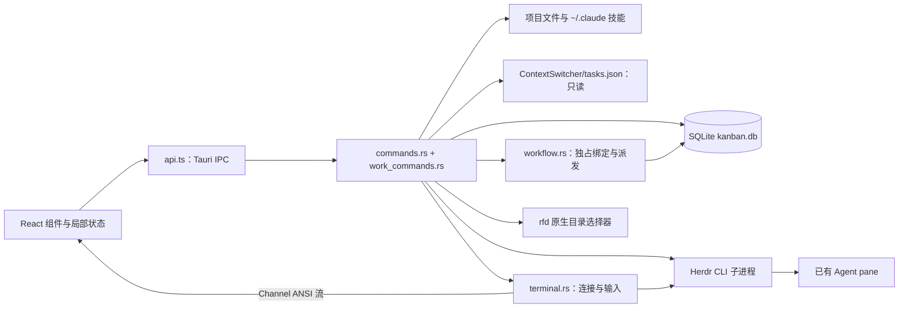
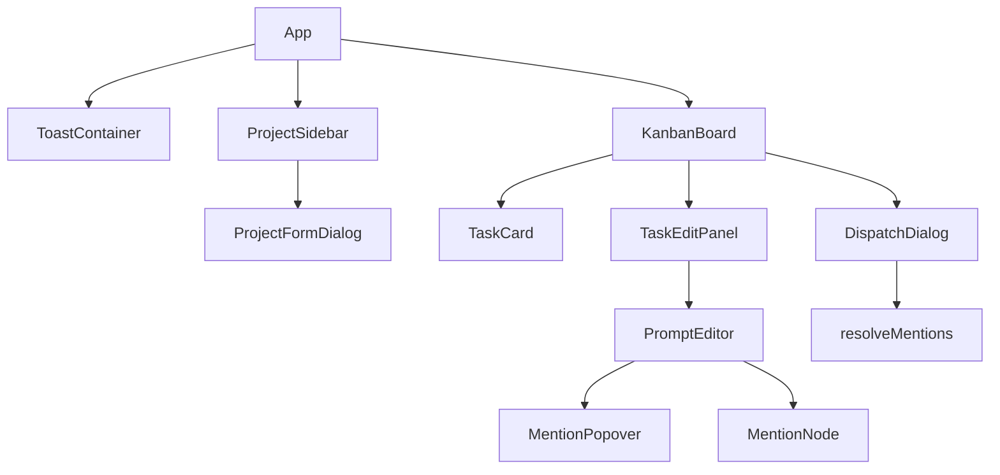
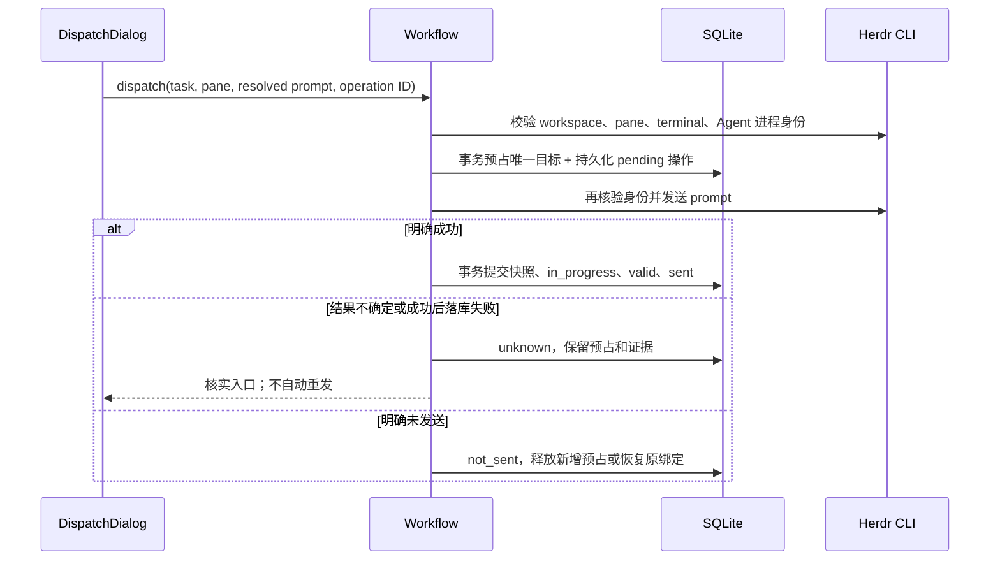

# Kanban 代码结构与关键流程分析

更新日期：2026-10-24。范围：`kanban/` 的前端、Rust 后端、数据库及构建配置，同时核对主项目的 ContextSwitcher 任务序列化格式。已加入任务独占 pane、右侧交互终端与恢复流程；验证证据和未覆盖项见[验收记录](docs/verification/2026-10-24-kanban-herdr.md)。

## 1. 项目定位与架构边界

Kanban 是同一仓库中的独立桌面应用，使用 React + TypeScript 构建界面，以 Tauri/Rust 提供 SQLite、文件系统、原生目录选择和 Herdr CLI 调用能力。它不是 Python/PySide6 主程序中的一个页面，也没有直接调用主程序的 TaskManager 或 WindowManager。

业务中心是“为本地项目维护任务卡片，编辑带文件/技能引用的提示词，再发送给已有 Herdr Agent”。当前已形成项目管理、三列看板、提示词编辑、引用搜索和派发的基本闭环。

必须区分三个概念：

| 概念 | 当前职责 | 关系的实际约束 |
| --- | --- | --- |
| ContextSwitcher Task | Python 主应用管理的窗口上下文及任务 | Kanban 只读取其摘要，不写回、不切换窗口 |
| Kanban Project | 看板容器，保存本地根目录、Herdr workspace 名称和可选 CS task ID | 一个项目有多张卡片；CS 关联可为空，且没有唯一约束 |
| Kanban Task | 项目中的单张卡片，含状态、提示词及最近一次派发信息 | 不等同于主应用 Task，也不映射主应用的 `todo_items` |

`CLAUDE.md` 中“一个 CS Task = 一个 Workspace = 一个 Project”是设计意图。代码没有强制一对一关系；workspace 也是文本标签，不是稳定 workspace ID。



没有业务 HTTP 服务、后台任务调度器或 Agent 完成回调。CRUD 通过 `invoke → Promise` 请求/响应传递；终端输出通过 Tauri Channel 流式传递。Herdr 继续拥有底层 Agent 进程，看板只管理其查看连接。

## 2. 目录与入口

```text
kanban/
├─ package.json / package-lock.json  前端依赖与 npm 脚本
├─ vite.config.ts                   Vite、开发端口、HMR
├─ tsconfig*.json                   TypeScript 编译约束
├─ index.html                      WebView 页面入口
├─ src/
│  ├─ main.tsx                     React 挂载，启用 StrictMode
│  ├─ App.tsx                      项目列表、项目选择及顶层布局
│  ├─ App.css                      全局主题、布局、组件样式与动画
│  ├─ Icon.tsx                     本地 SVG 线性图标
│  ├─ types.ts                     前端数据结构
│  ├─ api.ts                       Tauri IPC 适配层
│  ├─ ProjectSidebar.tsx           项目列表和管理入口
│  ├─ ProjectFormDialog.tsx        项目表单、目录选择、CS 任务关联
│  ├─ KanbanBoard.tsx              卡片加载、三列、拖拽及弹层协调
│  ├─ TaskCard.tsx                 卡片展示、派发/完成/删除入口
│  ├─ TaskEditPanel.tsx            名称和提示词编辑侧栏
│  ├─ PromptEditor.tsx             Tiptap 初始化与 JSON 输出
│  ├─ MentionNode.ts              自定义原子行内 mention 节点
│  ├─ MentionPopover.tsx           @/$ 搜索、键盘选择和节点插入
│  ├─ DispatchDialog.tsx           Agent 选择、预览和派发
│  ├─ TerminalPanel.tsx            xterm 渲染、输入、尺寸、连接代次
│  ├─ BindingDialog.tsx            显式修复独占绑定，不发送提示词
│  ├─ DispatchRecovery.tsx         核实不确定的派发结果
│  ├─ i18n.ts / locales/           新增界面的稳定翻译键
│  ├─ dispatchUtils.ts             引用展开为最终提示词文本
│  └─ Toast.tsx                    全局通知函数与展示容器
├─ src-tauri/
│  ├─ Cargo.toml / Cargo.lock      Rust 依赖
│  ├─ build.rs                     tauri_build::build()
│  ├─ tauri.conf.json              窗口、构建、资源、安全配置
│  ├─ capabilities/default.json    主窗口权限配置
│  └─ src/
│     ├─ main.rs                   调用 kanban_lib::run()
│     ├─ lib.rs                    初始化数据库、插件与命令注册
│     ├─ db.rs                     数据路径、建表、轻量迁移
│     ├─ models.rs                 Rust 模型及状态转换
│     ├─ commands.rs               CRUD、文件/技能和 CS 数据读取
│     ├─ work_commands.rs          派发、修复、终端的 IPC 适配
│     ├─ workflow.rs               任务绑定、派发操作及恢复事务
│     ├─ herdr.rs                  有界 CLI 调用、目标身份核验
│     └─ terminal.rs               Herdr JSONL 控制流、输入与安全释放
├─ public/、src/assets/、src-tauri/icons/  静态资源和图标
└─ dist/、node_modules/、src-tauri/target/ 构建产物与依赖目录
```

### 2.1 桌面启动顺序

1. [main.rs](kanban/src-tauri/src/main.rs) 调用 `kanban_lib::run()`；release 模式设置 Windows GUI subsystem。
2. [lib.rs](kanban/src-tauri/src/lib.rs) 创建数据目录，持有数据库实例锁，再打开 SQLite、执行迁移，将上次中断的 pending 派发标为 unknown。
3. 连接包装为 `Arc<Mutex<Connection>>`，CRUD 与 Workflow 共享。外部 Herdr 请求不持有数据库锁。
4. 注册插件、业务命令、Workflow 和 TerminalManager，再启动 Tauri 窗口；销毁窗口时释放本应用终端连接。
5. [main.tsx](kanban/src/main.tsx) 挂载 `App`；`App` 加载项目，自动选择列表中的第一个有效项目。
6. `KanbanBoard` 按项目 ID 加载卡片，按 workspace 名称查询 Agent。

数据库初始化发生在窗口启动前。创建目录、连接和建表失败使用 `expect` 终止，没有恢复界面。数据库命令通过一把 Mutex 串行访问同一连接。

### 2.2 构建与平台

前端声明使用 React 19、Tiptap 3、TypeScript 6、Vite 8；Rust 使用 Tauri 2、rusqlite 0.32（bundled SQLite）、serde、uuid、chrono、walkdir 和 rfd。声明范围与实际锁定版本应分别查看 `package.json` 和 lockfile。

`tauri.conf.json` 配置窗口为 1280×800，最小 900×600，标题为 Herdr Kanban。`dragDropEnabled: false` 配合当前 HTML 拖放实现，不能误当成“应用不支持拖拽”。Vite 固定端口 1420，设置 `TAURI_DEV_HOST` 时另用 1421 提供 HMR。

虽然保留 Tauri 模板的 mobile 入口属性，CS 数据路径依赖 `APPDATA`，外部执行依赖本机 `herdr`；现阶段应按 Windows 桌面工作流理解，不能据此宣称跨平台验收完成。

## 3. 前端组件与状态归属



| 模块 | 拥有的状态/职责 | 与外部的交互 |
| --- | --- | --- |
| [App.tsx](kanban/src/App.tsx) | `projects`、`selectedId`；从列表派生当前项目 | `listProjects`；把刷新函数下传侧栏 |
| [ProjectSidebar.tsx](kanban/src/ProjectSidebar.tsx) | 新建弹窗开关、编辑目标 | 删除前确认；完成 CRUD 后通知 App 重载 |
| [ProjectFormDialog.tsx](kanban/src/ProjectFormDialog.tsx) | 名称、根目录、workspace、CS task ID、保存状态和错误 | 创建/更新项目、选择目录、读取 CS 任务 |
| [KanbanBoard.tsx](kanban/src/KanbanBoard.tsx) | 卡片列表、加载、新建输入、拖拽状态、Agent 列表、编辑 ID、待派发对象 | 加载/创建/变更状态；协调编辑与派发弹层 |
| [TaskCard.tsx](kanban/src/TaskCard.tsx) | 展示卡片名称、状态和最近派发信息 | 编辑/派发回调；直接调用完成和删除 API |
| [TaskEditPanel.tsx](kanban/src/TaskEditPanel.tsx) | 名称与提示词草稿、saving | 显式保存；取消、遮罩、Esc 直接关闭 |
| [PromptEditor.tsx](kanban/src/PromptEditor.tsx) | Tiptap Editor 实例 | 接收 JSON 字符串；每次编辑输出序列化 JSON |
| [MentionPopover.tsx](kanban/src/MentionPopover.tsx) | 搜索词、引用种类、候选项、选择下标、展开状态 | 查询文件/技能；写入编辑器 transaction |
| [DispatchDialog.tsx](kanban/src/DispatchDialog.tsx) | Agent 列表、选中 pane、loading、错误、预览文本 | 重新查 Agent、展开引用、派发 |
| [Toast.tsx](kanban/src/Toast.tsx) | 通知数组及自增 ID | 模块级 `_notify` 指向容器回调，3 秒后删除通知 |

没有 Redux、Zustand 或查询缓存层。操作回调通知父组件重新查询，刷新期间保留已有卡片；只有首次空列表加载显示 loading 分支。请求代次阻止迟到列表覆盖新结果。App 用 Project ID 作为 KanbanBoard 的 key，切项目销毁旧任务选择、弹窗和终端连接。

表单草稿只存在内存里。任务编辑没有自动保存或未保存提醒；“保存提示词”和“派发提示词”是两个独立动作，派发读取卡片中已保存的 `prompt_json`。

### 3.1 样式与交互实现

[App.css](kanban/src/App.css) 集中定义深色中性色阶、语义色、间距、圆角以及组件样式。2026-10-24 界面调整借鉴 [Supabase 官网](https://supabase.com/) 的中性色、绿色强调、细边框和留白，在现有深色界面上实现：炭灰背景、`#3ecf8e` 主色、6/8px 圆角；根字号为 16px，任务标题、列标题与编辑正文为 16px，操作按钮和辅助文字为 14px，紧凑状态标签为 12px；侧栏宽度 248px，窄窗口收为 216px。左侧三列 grid 等宽、每列至少 200px；右侧终端默认 300px，最小 280px，分隔线支持拖动和方向键。空间不足时仅三列区域横向滚动；编辑侧栏宽 520px，保留 `max-width` 限制。动画包括侧栏滑入、遮罩淡入、Toast 滑入和加载旋转，并响应系统减少动效设置。

`App` 增加工作空间面包屑和项目目录层级；`ProjectSidebar` 增加品牌区、项目数量与明确的新建入口，项目选择使用原生按钮；`KanbanBoard` 增加任务总数、完成数量及聚焦底部输入框的新建按钮。Agent 派发区取消整体低透明度。`Icon.tsx` 提供本地 SVG 线性图标，替换看板空态与项目操作的字符图标，不加载远程字体或样式。任务卡片、项目表单、编辑侧栏、派发对话框、引用候选与通知使用同一套主题。

此前主题调整的浏览器模拟检查仅证明界面行为。本次补充了隔离 SQLite、真实 Tauri/WebView2 与 Windows Herdr 的终端输入和生命周期验收；见第 9 节及验收记录。

看板使用原生 `draggable`、`dataTransfer` 与 React 拖放事件，没有使用已经安装的 `@dnd-kit/*`。`draggingIdRef` 是拖放时的首选任务 ID 来源，代码注释说明这是对 WebView2 中 `getData()` 可能为空的兼容措施。

`@tiptap/extension-mention` 也没有用于当前引用链路；项目采用自定义 `MentionNode` 与 `MentionPopover`。前端 opener 包和 Rust opener/shell 插件存在，但业务调用 Herdr 用的是 Rust `std::process::Command`，不是 shell 插件 API。

## 4. 数据模型与持久化

源码入口：[types.ts](kanban/src/types.ts)、[models.rs](kanban/src-tauri/src/models.rs)、[db.rs](kanban/src-tauri/src/db.rs)。前后端模型手工维护，没有生成共享契约。

### 4.1 Project

| 字段 | 作用 |
| --- | --- |
| `id` | Rust 生成 UUID v4 字符串，主键 |
| `name` | 项目展示名称 |
| `root_path` | 文件搜索根目录；不是派发进程的工作目录 |
| `herdr_workspace` | Agent 列表筛选文本，同时进入派发目标记录 |
| `cs_task_id` | 可空的 CS 任务 ID，仅作为关联信息 |
| `created_at` | UTC RFC3339 字符串；项目列表按其排序 |

表单要求名称、根目录、workspace 非空，但 Rust CRUD 没有重复实施该校验，也没有验证目录存在、workspace 存在或 CS ID 有效。

### 4.2 Task

| 字段组 | 作用 |
| --- | --- |
| `id`、`project_id` | 卡片主键及所属项目；SQL 声明项目外键 |
| `name`、`status` | 名称与 `todo / in_progress / done` 三态 |
| `prompt_json` | Tiptap 文档的 JSON 字符串；新卡默认 `"{}"` |
| `prompt_snapshot` | 最近一次成功派发时实际发送的展开文本，可为空 |
| `dispatched_at`、`dispatched_to` | 最近一次派发时间与 `workspace/pane_id`，可为空 |
| `created_at`、`updated_at` | 创建及最后修改时间；任务列表按创建时间排序 |

新增数据表：

| 表 | 约束及用途 |
| --- | --- |
| `task_bindings` | task_id 主键；`UNIQUE(session,pane_id)` 跨项目保障独占；保存完整目标身份和 valid/reserved 状态 |
| `dispatch_operations` | 操作 ID 主键；pending/unknown/sent/not_sent；保存目标、实际 prompt、时间与人工核实依据；部分唯一索引限制每任务一个未决操作 |
| `schema_migrations` | 记录绑定与派发表的迁移版本，初始化可重复执行 |

Task 上的 `binding` 是列表返回的派生字段，不写入旧 tasks 表。没有结构化绑定的旧开发中任务返回 repair，旧共享目标不会自动认领。完成或移回未开发保留绑定；删除解除绑定，保留派发审计记录。`DispatchRecord` 仍是命令返回值，最近一次快照也继续保存在 Task 上。

### 4.3 数据路径、迁移与约束

默认数据库为 `%APPDATA%\herdr-kanban\kanban.db`；隔离验收可设置 `KANBAN_DATA_DIR`。它与 Python 主应用的 tasks.json 独立。启动持有同目录数据库锁，避免第二实例把活跃派发误判为中断；进程退出自动释放锁。

显式启用 `foreign_keys=ON` 和 3 秒 busy timeout。增量建表保留原项目、任务、prompt、快照及目标文本；原有 cs_task_id 迁移仍兼容。status 仍无 SQL CHECK，但状态命令只接受 todo/done，拒绝直接改为 in_progress；进入开发中必须经派发确认。pending/unknown 操作阻止删除相关任务/项目和变更状态，以保留核实证据。

## 5. IPC 命令契约

[api.ts](kanban/src/api.ts) 是唯一的前端 invoke 入口；[lib.rs](kanban/src-tauri/src/lib.rs) 注册命令；[commands.rs](kanban/src-tauri/src/commands.rs) 实现 CRUD，[work_commands.rs](kanban/src-tauri/src/work_commands.rs) 适配派发和终端服务。

参数在 TypeScript invoke 对象中使用 camelCase，例如 `rootPath`、`projectId`；Rust 函数参数和返回结构字段使用 snake_case。Rust 的 `Result<T, String>` 对应前端成功值或 Promise rejection，新增业务错误使用稳定 key 前缀，由 React i18n 映射；CLI 细节作为附加诊断。

| 命令 | 主要输入 | 返回/副作用 |
| --- | --- | --- |
| `list_projects` | 无 | `Project[]`，按创建时间排序 |
| `create_project` | name、rootPath、herdrWorkspace、csTaskId | 插入并返回 Project |
| `update_project` | id + 项目字段 | 更新项目，返回空 |
| `delete_project` | id | 删除项目；卡片清理由外键级联负责 |
| `list_tasks` | projectId | 项目内 Task[]，按创建时间排序 |
| `create_task` | projectId、name | 创建 todo 卡片并返回 Task |
| `update_task` | id、name、promptJson | 更新正文及 updated_at |
| `update_task_status` | id、status | 更新状态及 updated_at |
| `delete_task` | id | 删除卡片 |
| `search_files` | rootPath、query | 最多 50 个 FileEntry |
| `search_skills` | query | 最多 30 个 SkillEntry |
| `read_file_content` | absPath | UTF-8 文件全文 |
| `read_skill_content` | skillMdPath | UTF-8 SKILL.md 全文 |
| `herdr_list_agents` | workspace | 精确 workspace 标签匹配，返回带 occupied_by 的 Agent 列表 |
| `dispatch_to_herdr` | taskId、agentName（pane ID）、promptText、operationId | 后端从项目解析 workspace，预占后发送并落库 |
| `resolve_dispatch` | taskId、operationId、sent、evidence | 人工核实未知结果，不重发 |
| `repair_binding` | taskId、paneId | 显式验证并替换独占绑定，不重发 |
| `terminal_open` | taskId、connectionId、cols、rows、output Channel | 从任务解析有效目标；创建控制流 |
| `terminal_input` | connectionId、data | 再核验任务、绑定及身份后转发输入 |
| `terminal_resize` | connectionId、cols、rows | 有界尺寸更新 |
| `terminal_ack` | connectionId、bytes | 渲染消费确认，释放输出配额 |
| `terminal_close` | connectionId | 只释放指定查看连接 |
| `pick_folder` | 无 | 原生目录选择结果；取消返回 null |
| `read_cs_tasks` | 无 | CS 任务摘要 CsTask[] |

`dispatch_to_herdr` 的 `agentName` 实际传入 `pane_id`，不是 `HerdrAgent.name`。`name` 是 Agent 类型，`title` 用于展示，`pane_id` 才是发送目标。

## 6. 关键业务调用链

### 6.1 创建项目及关联 ContextSwitcher

`ProjectSidebar → ProjectFormDialog → readCsTasks/pickFolder → createProject/updateProject → Rust SQL → App.loadProjects()`。

表单每次挂载读取一次 CS 任务。选择一个 CS 任务时，仅在项目名称/workspace 当前为空的情况下自动填充，不会自动填根目录，也不会建立后续同步。CS 任务被删除或重命名后，现存 Project 不会自动修正。

`read_cs_tasks()` 读取固定 JSON 文件中的 `tasks` 数组，提取 `id`、`name`、`status`、`herdr_binding.label`；缺少 ID/名称的条目被跳过，文件不存在返回空列表。前端把读取/解析失败也转换为空列表，因此界面无法区分“没有任务”和“读取失败”。

主项目 [Task.to_dict()](core/task_manager.py) 确实输出 `herdr_binding: { workspace_id, label }`，[DataStorage.save_tasks()](utils/data_storage.py) 输出包含版本、时间和 `tasks` 的对象。Kanban 只取 label，不利用主程序已保存的稳定 workspace ID；也不执行主项目的旧格式迁移逻辑。

CS 的完成状态为 `completed`，Kanban 为 `done`。二者分别使用各自的模型，目前没有转换或状态联动。

### 6.2 创建、编辑和移动卡片

1. Todo 列输入名称，`handleAddTask()` 调用 `create_task`。
2. Rust 插入默认 todo 卡片，前端重新加载并用新 ID 打开 `TaskEditPanel`。
3. Tiptap 编辑内容经 `getJSON()` 序列化到面板草稿。
4. 显式保存调用 `update_task`，成功后关闭侧栏、刷新看板。
5. 卡片拖到“开发中”时打开 `DispatchDialog`，选择 Agent 并确认派发；确认前、取消或派发失败均保留原状态。派发成功后由 `dispatch_to_herdr` 更新状态和派发记录，前端重新查询后移动卡片。拖到“未开发”或“完成”时调用 `update_task_status`，成功后重新查询；拖到原列不执行更新。

列之间允许迁移，包括 done 回 todo；从 todo 或 done 进入 in_progress 必须经过派发确认。同一列内部没有手动排序，也没有顺序持久化。“标记完成”按钮只出现在 in_progress 卡片；拖放可以把任意状态卡片直接移到 done。

看板快捷键是无 Ctrl/Meta/Alt 修饰的小写 `n`，聚焦新增输入框；输入框 Enter 新建，Escape 清空并失焦。全局快捷键排除 input、textarea、contenteditable 和右侧终端，终端键盘事件不冒泡至看板。

### 6.3 @ 文件与 $ 技能引用

`PromptEditor → MentionPopover → searchFiles/searchSkills → 选择候选 → 插入 MentionNode → prompt_json`。

节点保存的是引用位置，不是引用正文：

```json
{
  "type": "mention",
  "attrs": {
    "kind": "file",
    "label": "src/App.tsx",
    "ref": "E:/MyProject/src/App.tsx"
  }
}
```

`kind` 为 `file` 或 `skill`，`label` 展示名称，`ref` 保存搜索返回的路径。自定义节点为 inline + atom，渲染为不可编辑的 chip。

候选触发正则为 `/([@$])([\w./_-]*)$/`，支持拉丁字母、数字、下划线和部分路径字符，不支持中文查询词、空格、反斜杠或盘符冒号。候选列表支持上下方向键、Enter/Tab、鼠标选择；Escape 关闭。弹层是相对编辑器的绝对定位，未计算光标坐标。

| 搜索能力 | 当前实现与限制 |
| --- | --- |
| 文件搜索 | WalkDir 递归、不跟随符号链接；按文件名做大小写不敏感 contains，非全文、非完整相对路径匹配 |
| 文件排除 | 过滤包含 node_modules、.git、target、__pycache__、.venv、dist、build 的路径；不读取 .gitignore |
| 文件结果 | 先取遍历中的前 50 条，再按相对路径排序；不是全量排序后取前 50 条 |
| 技能搜索 | 扫描 USERPROFILE/HOME 下整个 `.claude`，寻找 SKILL.md；不扫描 `.codex/skills`、`.agents/skills` 或项目技能目录 |
| 技能元数据 | 手工从 frontmatter 读取单行 name/description，非完整 YAML 解析；无 name 时使用父目录名 |
| 技能结果 | 名称或描述 contains 匹配，最多 30 条；无显式排序/去重 |

文件排除使用迭代后的 `filter`，没有 `filter_entry` 目录剪枝，排除目录仍可能被遍历。查询没有 debounce 或缓存。候选 effect 的 cancelled 标记防止过期结果写回，但不会停止已经发起的 Rust 扫描。

### 6.4 派发到 Herdr

存在三个入口：卡片“派发/再派发”按钮、把其他列的卡片拖到“开发中”，或把卡片拖到顶部 Agent chip。拖到“开发中”打开未预选目标的派发对话框；拖到 Agent chip 打开预选该目标的对话框。两种拖放均不会立即发送或提前修改任务状态。done 卡片没有派发按钮，但仍可拖到“开发中”或 Agent 重新派发。



**Agent 发现。** 精确匹配唯一 workspace label，读取 agent list 与 pane process-info；缺失、歧义或无法核实身份的目标不可选。目标身份包含 session、workspace ID、pane ID、terminal ID、Agent 类型以及 shell PID/前台进程组。标题只展示，不参与身份判定。默认使用本机 default session。

派发和修复对话框可以刷新列表，其他任务占用目标显示为禁用；后端数据库约束仍是最终保障。再派发复用已有有效目标。顶部 Agent 栏在项目 workspace 变化时刷新，其拖放仍需进入对话框确认，不直接发送。

**预览。** `buildPreview()` 调用本地 `extractTextWithMentions()`，只展示普通文本与 `[@文件: ...]`、`[$技能: ...]` 占位符，没有读取引用正文。2026-10-24 将按钮文案改为“预览提示词”，避免暗示已展开引用；解析行为保持不变。

**实际展开。** [resolveMentions()](kanban/src/dispatchUtils.ts) 递归处理文档：普通文字直接追加；文件正文放入带路径的分隔标题和代码块；技能正文直接附在技能标题后。段落和标题补换行；并非完整 Markdown 序列化，粗体、列表、hardBreak 等结构没有对应的完整格式恢复。

引用读取按文档顺序逐个 await，无缓存和去重。每次派发读取当时的文件内容，可能与编写提示词时不同。单个引用读取失败会替换为“引用失败”文本并继续发送；参数 `_rootPath` 当前未使用，读取路径不会重新限制在项目根目录内。

**执行及落库。** CLI 用参数数组执行，不通过 shell 拼接；常规请求超时 12 秒、stdout/stderr 各限 4 MiB。操作 ID 防止重复提交，未知结果须人工核实。返回成功意味着 Herdr 控制接口确认了 prompt 请求且数据库提交成功，不代表 Agent 已完成业务。

### 6.5 右侧终端与恢复

点击开发中卡片先更新本地高亮和标题，TerminalPanel 创建唯一 connectionId，经 terminal_open 请求任务对应的目标。旧 effect 立即禁用输入、清理 xterm 和监听器、按旧 ID 释放连接；迟到输出不能写入新的 xterm。完成、移回 todo、删除及切项目也清理连接。

本机 Herdr 的 Windows `agent attach` 实测不支持直接连接，因此使用同版本已验证的 `terminal session control <pane> --cols N --rows N` JSONL 控制协议。Rust 将 terminal.frame 的 base64 ANSI 数据送入 xterm，将输入/resize 转为 terminal.input/terminal.resize；关闭发送 terminal.release，只终止本应用控制器，不关闭底层 pane/Agent。没有强制 takeover。

连接首帧限时 8 秒；每个输入批次重新核验目标，后台每 2 秒检查身份。输出分片 8 KiB，未消费窗口约 128 KiB，消费停滞 10 秒断开；单帧上限 8 MiB，前端 scrollback 3000 行，输入队列上限 64 KiB。断线时禁用输入并提供重连/修复入口。重连只建立查看连接，修复只改绑定，两者均不调用 prompt。

## 7. 当前实现的关键边界与维护风险

以下区分可直接确认的行为与需要运行时复现的风险，不把静态分析当成桌面验收。

| 边界 | 当前状态 |
| --- | --- |
| 双重占用、派发重试、外部成功后落库失败 | 已由唯一约束、操作记录与人工核实覆盖；不确定目标继续隔离，其他 pane 可用 |
| 项目/任务切换及迟到响应 | Project key、加载代次、connectionId 及终端取消共同隔离 |
| Herdr 版本兼容 | 已实测当前 Windows 预览版；JSONL 控制协议变化需重新验收，失败不能降级为只读并宣称成功 |
| 引用正文大小及根目录 | 仍直接读取引用路径全文；超大或根外引用不在本次范围 |
| prompt 作为命令行参数 | 仍受 Windows 命令行长度限制；启动前失败不伪装为发送成功 |
| 预览与发送转换逻辑 | 仍分离，引用读取失败仍进入最终 prompt；非本次重构范围 |
| CRUD 与既有界面本地化 | 本次新增界面使用稳定键；原有界面未做全站迁移 |
| Python 全量测试 | 现有 test_explorer_helper.py 语法错误阻断收集，见验收记录 |

还有两项配置边界值得保留：`csp` 当前为 null；capabilities 声明 opener/shell 权限，但现有文件读取与进程执行走自定义 Rust 命令。不能把插件权限列表当作这些命令已经具备路径或目标校验的证据。

## 8. 代码组织评价与后续修改入口

当前结构的优点是入口清楚、组件职责容易定位、IPC 集中、模型较小；SQL、CLI 和文件访问都留在 Rust，React 不直接持有数据库连接。对于本地单用户看板，这种结构便于快速迭代。

主要复杂度集中在两个位置：`KanbanBoard` 同时协调列表、拖放、Agent 和弹层生命周期；`workflow.rs` 集中处理绑定与派发一致性，`terminal.rs` 集中处理查看连接；`commands.rs` 保留既有 CRUD 和文件/技能读取。扩展时应先围绕明确业务边界拆分，而不是单纯按文件长度拆文件。

| 要做的改动 | 首先阅读/修改 | 必须同步考虑 |
| --- | --- | --- |
| 新增任务状态或转换规则 | types.ts、models.rs、KanbanBoard、TaskCard、commands.rs | SQL 状态约束、旧数据迁移、颜色/按钮、派发强制 in_progress 的语义 |
| 新增项目/任务字段 | models.rs、types.ts、db.rs、commands.rs、api.ts | SELECT 列顺序与 row_to_task、表单、迁移、现有库兼容 |
| 修改提示词或引用格式 | PromptEditor、MentionNode、MentionPopover、dispatchUtils、DispatchDialog | 历史 prompt_json、预览一致性、失败引用、格式保留 |
| 接入更多技能目录 | commands.rs 的 search_skills | 发现路径配置、去重、排序、缓存、完整 frontmatter 解析 |
| 改 Herdr 协议或派发可靠性 | herdr.rs、workflow.rs、work_commands.rs、terminal.rs | 稳定目标 ID、超时、结果解析、重复发送、落库失败 |
| 增加 Agent 自动完成同步 | 独立结果接收/查询模块，加任务状态服务 | 任务与执行实例映射、重复/乱序通知、用户手动状态冲突；当前没有此链路 |
| 加深 CS 集成 | read_cs_tasks、ProjectFormDialog、主项目序列化 | 稳定 workspace ID、completed/done 差异、单向/双向数据所有权 |
| 修改布局与主题 | App.css、对应组件 | WebView2 原生拖放、最小窗口尺寸、遮罩层级和输入焦点 |

现已按实际业务边界拆出 Workflow、Herdr CLI 与 TerminalManager。后续若修改这些规则，优先通过命令所调用的服务入口验证任务状态、发送次数、SQLite 结果和底层进程生命周期，不为每个 CLI 子命令建立独立业务模型。

## 9. 构建检查与验收边界

常用命令如下，前端命令在 `kanban/` 执行，Rust 检查在 `kanban/src-tauri/` 执行：

```powershell
# 前端静态检查
.\node_modules\.bin\tsc.cmd --noEmit

# 看板拖放与派发组件回归（模拟 Tauri IPC，不发送真实任务）
npm test

# 前端生产构建；包含 tsc
npm run build

# Rust 检查（本次采用本地缓存，不更新锁文件）
cargo check --offline --locked

# 桌面开发 / 完整桌面打包
npm run tauri dev
npm run tauri build
```

单独 `npm run dev` 或 `npm run preview` 只提供前端页面；当前没有浏览器 mock API，依赖 Tauri invoke 的功能需要桌面宿主。

本次结果和明确的覆盖限制集中维护在[验收记录](docs/verification/2026-10-24-kanban-herdr.md)。前端组件测试只模拟 Tauri；真实 Windows 验收另行使用隔离数据库、真实 WebView2 和 Herdr Agent。Rust 的两个 live 测试默认 ignored，必须显式提供以 kanban-acceptance- 开头的测试 workspace 才能执行，不向个人工作 pane 发送探针。

## 10. 推荐阅读路线

初次接手时按以下顺序阅读，能先理解整体，再追踪关键风险：

1. `types.ts → models.rs → db.rs`：厘清 Project、Task、引用和派发快照。
2. `main.tsx → App.tsx → KanbanBoard.tsx`：理解页面和状态归属。
3. `api.ts → lib.rs → commands.rs/work_commands.rs → workflow.rs/herdr.rs/terminal.rs`：对应每个动作的 IPC、SQL 与外部副作用。
4. `TaskEditPanel → PromptEditor → MentionNode/MentionPopover`：理解 prompt_json 如何产生。
5. `DispatchDialog → dispatchUtils → dispatch_to_herdr`：理解“草稿、预览、实际发送、快照”之间的差异。
6. `ProjectFormDialog → read_cs_tasks → 主项目 Task.to_dict()`：核对跨项目数据契约。

## 11. 规格与实施对应

已实现[任务独立 pane 与右侧交互终端规格](docs/superpowers/specs/2026-10-24-kanban-herdr-task-pane.md)的主流程，来源为 [GitHub #4](https://github.com/legendxcheng/ContextSwitcher/issues/4)，拆分为 #5–#9。实现采用当前 Windows Herdr 可用的 JSONL 控制流，替代原先待验证的 agent attach/伪终端方案。未验收的系统 DPI 与独立打包环境在验收记录中单列。
